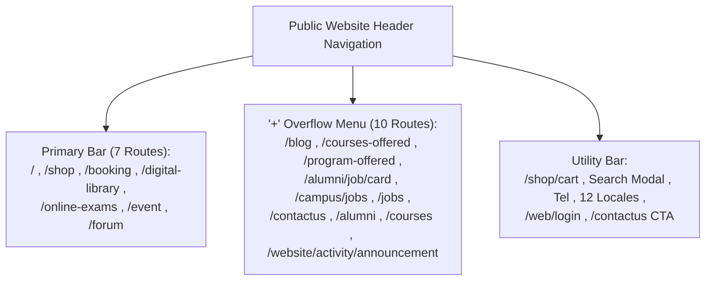

# 01 — UI/UX Design System, Authentication & Public Website Specification

> **Source Instance:** `https://21058239.o19.oeducat.org` (Odoo 19 Enterprise / OpenEduCat SaaS)  
> **Target Client Customization Context:** **Oshwal Academy Nairobi** (`https://oan.oshwalacademy.sc.ke/academics/`)  
> **Host-Verified Origins:** `https://21058239.o19.oeducat.org`, `https://oan.oshwalacademy.sc.ke`

---

## 1. Global UI/UX Design System & Shell Anatomy

### 1.1 Typography & Color Tokens

| Surface | Token / Property | OpenEduCat Default (`21058239.o19.oeducat.org`) | Oshwal Academy Nairobi Target (`oan.oshwalacademy.sc.ke`) |
|---|---|---|---|
| **Backend ERP (`/openeducat`)** | Primary Brand Color | `#1565C0` (Royal Blue) | `#1e3f7c` / `#21407a` (Oshwal Deep Navy Blue) |
| **Backend ERP (`/openeducat`)** | Workspace Background | `#f9fbfc` (Cool Off-White) | `#f9fbfc` / `#fcf5ea` (Warm Cream Accent) |
| **Backend ERP (`/openeducat`)** | Font Family | `Rubik` (Theme Customizer selectable: `Rubik`, `sans-serif`, `Poppins`, `Lato`, `Merriweather`, `Montserrat`, `OpenSans`, `PlayfairDisplay`) | `Poppins` / `Montserrat` / `Rubik` |
| **Public Website (`/`)** | Header Navigation Bar | White sticky bar (`#ffffff`), dark charcoal links | Deep Navy (`#1e3f7c`) top bar + Crimson Red (`#ec1c24`) main navbar + Golden Yellow (`#f4cb00`) CTA |
| **Public Website (`/`)** | Primary Button (`btn-primary`) | Muted Plum/Burgundy (`#714B67`) | Crimson Red (`#ec1c24`) / Golden Yellow (`#f4cb00`) |
| **Public Website (`/`)** | Section Highlight Cards | Light gray (`#f8f9fa`) | Coral Pink (`#f68b92`), Periwinkle Blue (`#91a3c7`), Soft Cream (`#fcf5ea`), Pale Blue (`#cfdfff`) |
| **Public Website (`/`)** | Footer Background | Warm light gray | Golden Yellow (`#f4cb00`) with Navy text & accreditation badges |

### 1.2 Backend Application Shell Anatomy (`nav.o_main_navbar`)
1. **Top-Left App Switcher & Brand:**
   - Grid icon (`a.o_menu_toggle`) toggling `/openeducat/apps_menu` (`Menu Style = Apps`) or collapsible left sidebar (`Menu Style = Sidebar`).
   - Current Module Brand Title (`a.o_menu_brand`, e.g., `Admissions`, `SIS`, `Exams`).
2. **Primary Module Navigation (`div.o_menu_sections`):**
   - Horizontal dropdowns and direct action links specific to the active module (e.g., `Admissions`, `Reporting`, `Configuration`).
3. **Top-Right Systray (`div.o_menu_systray`):**
   - **Discuss / Messages (`i.fa.fa-lg.fa-comments`):** Live unread counter badge (e.g., `15`), dropdown for Channels, Direct Messages, and Live Chat threads.
   - **Activities (`i.fa.fa-lg.fa-clock-o`):** Counter badge (e.g., `28`), grouped by model (`Student`, `Admission`, `CRM Lead`, `Helpdesk Ticket`) with `Late`, `Today`, `Future` counts.
   - **No-Code View Editor (`div.web_no_code_studio_toggle`, `i.fa.fa-wrench.text-primary`):** Live XML/View inspector and field customizer.
   - **Theme Customizer (`li.f_theme_customizer`, `span.fa.fa-cogs`):** Side drawer controlling `Menu Style` (`Apps` vs `Sidebar`), `Font Type`, `Brand Color`, `Background Color`, `Dark Mode`, and `Chatter Position` (`Sided` vs `Bottom`).
   - **Multi-Company / Campus Switcher (`div.o_switch_company_menu`):** Multi-select checkboxes + active company highlight (`OpenEduCat`, `My US Company`, `My Company (Chicago)`, `Campus 2`).
   - **User Menu (`div.o_user_menu`):** Avatar + green online status dot; 12 instant language switches (`العربية`, `简体中文`, `Nederlands`, `English (US)`, `Français`, `Deutsch`, `Bahasa Indonesia`, `Italiano`, `Português`, `русский язык`, `Español`, `Tiếng Việt`), `Help`, `Shortcuts CTRL+K`, `Online`, `My Preferences`, `Preferences`, `My Odoo.com Account`, `Log out`.
4. **Bottom-Right Floating Action Dock:**
   - Collapsible blue action pill (`fa-arrow-left` / `fa-arrow-right`) exposing `Toggle Fullscreen` and quick `Search` triggers.

### 1.3 Control Panel & View Switcher Anatomy (`div.o_control_panel`)
- **Left Zone:**
  - Primary Action CTA (`button.btn.btn-primary`, e.g., `New`, `Upload`, `Generate Leads`)
  - Breadcrumb trail + Record title + `Actions` gear icon (`button.o_cp_action_menus`, `data-hotkey="u"`, exposing `Export`, `Archive`, `Unarchive`, `Duplicate`, `Delete`, and print reports).
- **Center Zone (`div.o_cp_searchview`):**
  - Unified search input (`Search...`) with active facet chips (e.g., `Today`, `My Sessions`, `Active`).
  - `Toggle Search Panel` dropdown (`shift+q`) with 3 columns:
    - **Filters (`fa-filter`):** Predefined domain filters + `Custom Filter...` builder.
    - **Group By (`fa-bars`):** Predefined field groupings + `Add Custom Group` dropdown listing all groupable model fields.
    - **Favorites (`fa-star`):** `Save current search` (with `Default filter` and `Shared` checkboxes).
- **Right Zone:**
  - Bookmark / Share icon
  - Record Pager (`1-80 / 167` with `<` `p` and `>` `n` buttons)
  - View Switcher Bar (`nav.o_cp_switch_buttons`):
    - `Kanban` (`o_kanban`)
    - `List` (`o_list`)
    - `Calendar` (`o_calendar`)
    - `Pivot` (`o_pivot`)
    - `Graph` (`o_graph` — Bar, Line, Pie)
    - `Activity` (`o_activity`)

### 1.4 Form View Sheet & Chatter Anatomy (`div.o_form_view`)
- **Status Header Bar (`div.o_form_statusbar`):**
  - Left (`div.o_statusbar_buttons`): Workflow transition buttons (`btn-primary` for next primary action, `btn-secondary` for secondary/reset/cancel actions).
  - Right (`div.o_statusbar_status`): Interactive chevron stage pills (`button.o_arrow_button`, with `.o_arrow_button_current` highlighting active stage).
- **Form Sheet (`div.o_form_sheet_bg > div.o_form_sheet`):**
  - **Smart Button Box (`div.oe_button_box`):** Top-right row of contextual drill-down stat buttons (`button.oe_stat_button` with FontAwesome icon + `o_stat_value` + `o_stat_text`, overflowing into a `More` dropdown when >7 buttons).
  - **Ribbon Widget (`div.ribbon`):** Diagonal top-right status banner (e.g., `PUBLISHED`, `DONE`, `PAID`, `ARCHIVED`).
  - **Avatar & Title Block (`div.oe_title`):** Right-floated `o_field_image` (`image_1920`) + `h1` inline title/name inputs (`first_name`, `middle_name`, `last_name` or `name`).
  - **Two-Column Field Groups (`div.o_group`):** Responsive 2-column grid (`o_inner_group`) pairing `<label class="o_form_label">` with field widgets (`char`, `many2one`, `many2many_tags`, `selection`, `date`, `datetime`, `daterange`, `float`, `monetary`, `boolean`, `priority`).
  - **Notebook Tabs (`div.o_notebook`):** Horizontal `<ul class="nav nav-tabs">` switching between relational `one2many` editable grids, HTML rich-text editors, and configuration panels.
- **Sided Chatter Panel (`div.o-mail-ChatterContainer`):**
  - Top composer bar: `Send message`, `Log note`, `Activities`, `Attachments` counter, and `Followers` list (`Add Followers` / `Follow`).
  - Chronological audit trail logging field tracking diffs, stage transitions, emails, and internal notes.

---

## 2. Authentication & Multi-Role Login Page (`/web/login`)

- **URL:** `https://21058239.o19.oeducat.org/web/login?redirect=%2Fopeneducat%3F`
- **Page Title:** `Login | My Website`
- **Demo Role Selector (`div.demo-login-buttons` — `"Login as"`):**
  | Role Button | Icon | `data-username` | Post-Login Destination |
  |---|---|---|---|
  | `Student` | `fa-graduation-cap` | `student@openeducat.com` | `/my` (Student Portal — 35 Portal Cards) |
  | `Faculty` | `fa-user` | `faculty@openeducat.com` | `/openeducat/apps_menu` (35 Backend Apps) |
  | `Parent` | `fa-users` | `parent@openeducat.com` | `/my` (Parent Portal — 35 Portal Cards) |
  | `Admin` | `fa-user-secret` | `admin` | `/openeducat/apps_menu` (All 53 Backend Apps) |
  | `Backoffice` | `fa-briefcase` | `backoffice@openeducat.com` | `/openeducat/apps_menu` (25 Backend Apps) |
- **Form Schema (`form.oe_login_form`, `POST /web/login`):**
  - Hidden fields: `csrf_token`, `type`, `webauthn_response`, `redirect`
  - Visible inputs: `Email` (`input#login[name="login"][required]`), `Password` (`input#password[name="password"][type="password"][required]`) + eye toggle (`button.o_show_password`)
  - Links & CTAs: `Reset Password` (`/web/reset_password`), `Log in` (`button[type="submit"].btn.btn-primary`), `Don't have an account?` (`/web/signup`), `Use a Passkey` (`a.passkey_login_link`).

---

## 3. Complete Audit of All 18 Public Website Routes

| # | Route | Access Level | Page Title | UI Layout, Filters, Cards & Forms |
|---|---|---|---|---|
| 1 | `/` | Public (`200`) | `Home \| My Website` | Shared header + `

` + 3-column footer (`Useful Links`, `About us`, `Connect with us`) + 12 language switches. |
| 2 | `/shop` | Public (`200`) | `Products \| My Website` | eCommerce product grid with left attribute filter sidebar (`Color`, `Height`, `Duration`, `Fabric`, `Legs`, `Price Range`), Category pills (`Desks`, `Furnitures`), `Pricelist: Benelux`, `Sort By: Featured`. |
| 3 | `/booking` | Public (`200`) | `Booking \| My Website` | Online Appointment booking portal (`Meeting with Principle`, `Parents Meeting`, `Meeting with Management`, `Volleyball Court` when published). |
| 4 | `/digital-library` | Public (`200`) | `Library Category \| My Website` | Public Digital Library catalog with category filter pills (`Kids`, `Technology`, `Programming`), search bar, and 6 e-book cards with cover art and `View Detail` CTA. |
| 5 | `/online-exams` | **Auth Required (`303 -> /web/login`)** | `Online Exams` | Protected route. Once logged in as `Student`, renders available online quizzes/exams (3 active quizzes) with `Start Quiz` button. |
| 6 | `/event` | Public (`200`) | `Events \| My Website` | Campus & public events directory with filter dropdowns (`Activity`, `Type`, `Age`, `Scheduled Events`, `Pricelist`), event cards with date badges, venue, and registration status. |
| 7 | `/forum` | Public (`200`) | `Forum Navigation \| My Website` | Community & LMS Course Forums list (`Help`, `Business Analysis & Process Management`, `Creative Thinking`, `Cybersecurity for Everyone`, etc.) with question/post counts. |
| 8 | `/blog` | Public (`200`) | `Blog Posts \| My Website` | Blog portal with category filter bar (`All`, `Travel`, `Astronomy`), featured post hero, and article cards. |
| 9 | `/courses-offered` | Public (`200`) | `Courses-Offered \| My Website` | **Online Admission Course Catalog:** Left filters (`Course Category`: Language, Programming, Management, Arts; `Price Filter`: Free/Premium). Clicking `Apply` navigates to `/courses-details/<slug>` → `Apply` → `/courses-offered/register/<slug>` (**Dynamic Online Admission Form** with `First Name*`, `Middle Name`, `Last Name*`, `Gender`, `Birth Date`, `Phone*`, `Email*`, `Street`, `City`, `Zip`, and `Submit` button creating an `op.admission` record in `Online Admission` / `Submitted` stage). |
| 10 | `/program-offered` | Public (`200`) | `Program-Offered \| My Website` | **Online Admission Program Catalog:** Left filters by `Program Level` (`Masters`, `Bachelors`, `Certificate Programs`, `Diploma`, `Doctoral`) + `Apply` buttons. |
| 11 | `/alumni/job/card` | **Auth Required (`303 -> /web/login`)** | `Alumni Jobs` | Protected route for authenticated alumni/students to browse and post alumni job cards. |
| 12 | `/campus/jobs` | **Auth Required (`303 -> /web/login`)** | `Campus Jobs` | Protected route for authenticated students to apply to internal campus job postings (`op.job.post`). |
| 13 | `/jobs` | Public (`200`) | `Jobs \| My Website` | Public HR Recruitment career board (`hr.job`) listing open staff/faculty roles (`Experienced Developer`, `Marketing and Community Manager`, `Consultant`) with online CV upload form. |
| 14 | `/contactus` | Public (`200`) | `Contact Us \| My Website` | Public inquiry form (`Name*`, `Phone Number`, `Email*`, `Company`, `Subject*`, `Question*`, `Submit`) linked to CRM lead creation + company address sidebar. |
| 15 | `/alumni` | Public (`200`) | `Alumni \| My Website` | Public Alumni network directory displaying graduation batch groups (`AD-2017`, `AD-2018`, `AD-2019`). |
| 16 | `/courses` | Public (`200`) | `Courses \| My Website` | **LMS eLearning Catalog:** Left filter sidebar (`Categories`, `Rating`, `Pricing: Free/Paid`), search bar, and course cards (`Leadership Skills`, `Creative Thinking`, etc.) with `Enroll Course` button. |
| 17 | `/website/activity/announcement` | Public (`200`) | `Activity Detail \| My Website` | **Campus Placement Drives Portal:** Lists corporate placement announcements (`Application Engineer`, `Site Engineer`, `Construction Manager`) with eligibility criteria, recruitment process steps, and application links. |
| 18 | `/shop/cart` | Public (`200`) | `Shopping Cart \| My Website` | 3-step eCommerce checkout (`Order` → `Address` → `Payment`) with `Quick reorder` and `Shop` buttons. |
