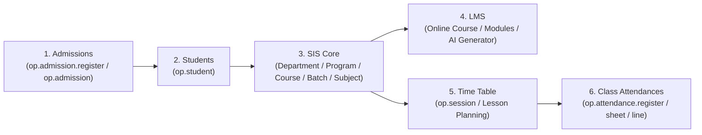
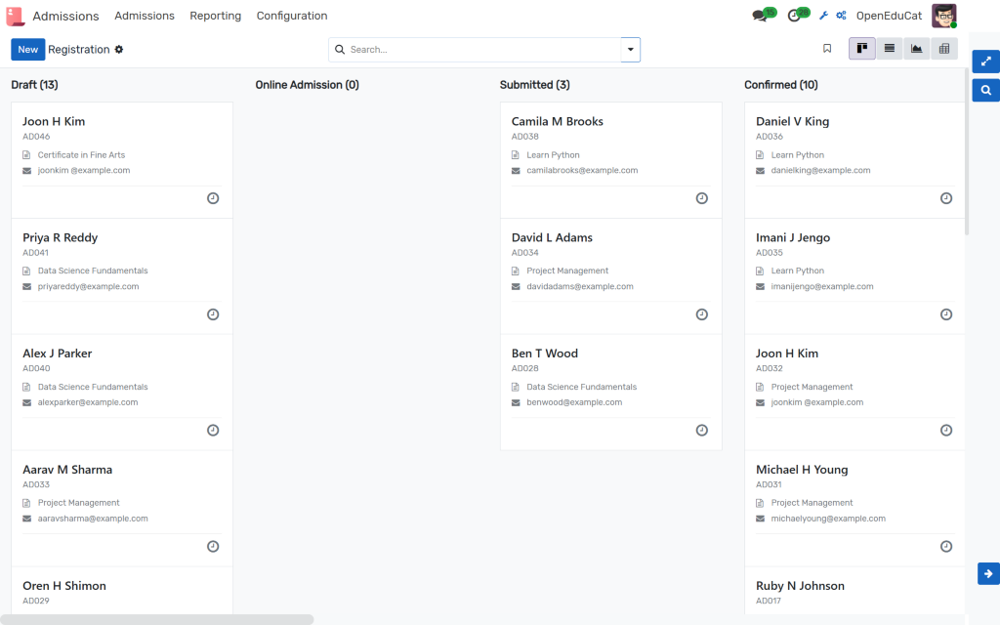
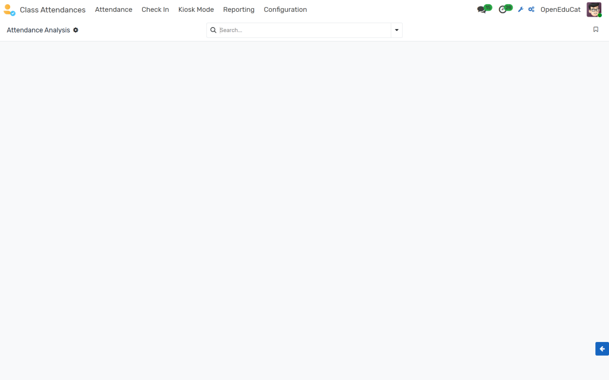

# 02 — Core Education & Academic Lifecycle Modules (Modules 1–6)

> **Source Instance:** `https://21058239.o19.oeducat.org` (Odoo 19 Enterprise / OpenEduCat SaaS)  
> **Target Client Customization Context:** **Oshwal Academy Nairobi** (`https://oan.oshwalacademy.sc.ke/academics/`)  
> **Verification Status:** 100% Live DOM & Network Verified (Zero Hallucination)

---

## Architecture Overview (Modules 1–6)

---

## Module 1: Admissions (`openeducat_admission.menu_op_admission_root`)

### 1.1 Complete Navigation & Action Hierarchy

| Menu Path | Label | Route / Action | XML ID | Target Model | View Modes |
|---|---|---|---|---|---|
| `Admissions > Admission` | Admission | `/openeducat/admission-register-kanban` | `openeducat_admission.menu_admission_register` | `op.admission.register` | Kanban, List, Form |
| `Admissions > Applications` | Applications | `/openeducat/admission` | `openeducat_admission.menu_admission` | `op.admission` | Kanban, List, Graph, Pivot, Form |
| `Admissions > Course Change Request` | Course Change Request | `/openeducat/student-course-change-req` | `openeducat_course_change_request.menu_course_change_req` | `student.course.change.request` | List, Form |
| `Reporting > Admission Report` | Admission Report | `/openeducat/action-1077` | `openeducat_admission.menu_admission_analysis` | `admission.analysis` | Wizard Modal (Form) |
| `Reporting > Admission Analysis` | Admission Analysis | `/openeducat/action-1326` | `openeducat_admission_enterprise.menu_op_admission_analysis` | `op.admission` | Pivot, Graph |
| `Configuration > Settings` | Settings | `/openeducat/res-config-settings` | `openeducat_admission.menu_admission_config_settings` | `res.config.settings` | Form |
| `Configuration > Admission Stages` | Admission Stages | `/openeducat/action-1322` | `openeducat_admission_enterprise.admission_stage_menu` | `op.admission.stage` | List, Form |
| `Configuration > Admission Tags` | Admission Tags | `/openeducat/action-1332` | `openeducat_admission_enterprise.admission_tag_menu` | `op.admission.tag` | List, Form |
| `Configuration > Admission Templates` | Admission Templates | `/openeducat/admission-templates` | `openeducat_dynamic_admission.menu_action_op_admission_customtemplate_list` | `op.admission.custom.template` | List, Form |

### 1.2 Admission Registers (`op.admission.register`)

- **Kanban View (`/openeducat/admission-register-kanban`):**
  - Left Search Panel Facets: `COURSE` (`All`, `BCA-CC-Semester-1`, `BCOM-AF-Semester-1`, `BTECH-CE-Semester-1`, `BA-PY-Semester-1`, `Learn Python`, `Certificate in Fine Arts`, `Project Management`, `Beginner German`, `Data Science Fundamentals`).
  - Card Anatomy: Corner ribbon (`PUBLISHED` / `DONE`), favorite star (`is_favorite`), Register title, Course subtitle, Start–End date range, status counters (`Draft`, `Confirm`, `Enroll`), `Template` link, and full-width primary CTA button `Applications (N)`.
- **Form View (`/openeducat/admission-register-kanban/13` — *Certificate in Fine Arts*):**
  - **Header Action Buttons:**
    - `Start Admission` (`name="start_admission"`, `btn-primary`)
    - `Reset to Draft` (`name="action_reset_to_draft"`, `btn-secondary`)
  - **Statusbar Pipeline (`state`):** `Draft` (`draft`) → `Confirmed` (`confirm`) → `Application Gathering` (`application`) → `Admission Process` (`admission`) → `Done` (`done`)
  - **Smart Buttons:** `5 Applications` (`name="open_student_application"`)
  - **Field Schema:**
    | Field Technical Name | UI Label | Field Type | Required | Readonly (in `application` state) |
    |---|---|---|---|---|
    | `name` | Name | `char` | Yes | Yes |
    | `admission_base` | Admission Base | `selection` (`Course` / `Program`) | No | Yes |
    | `academic_years_id` | Academic Year | `many2one` (`op.academic.year`) | Yes | Yes |
    | `course_id` | Course | `many2one` (`op.course`) | Yes | Yes |
    | `academic_term_id` | Terms | `many2one` (`op.academic.term`) | No | Yes |
    | `start_date` | Start Date | `date` | Yes | Yes |
    | `end_date` | End Date | `date` | No | Yes |
    | `max_count` | Maximum No. of Admission | `integer` | No | Yes |
    | `min_count` | Minimum No. of Admission | `integer` | No | Yes |
    | `product_id` | Course Fees | `many2one` (`product.product`) | Yes | Yes |
    | `registration_fees` | Registration Fees | `boolean` | No | Yes |
    | `minimum_age_criteria` | Minimum Required Age(Years) | `integer` | No | Yes |
    | `company_id` | Company | `many2one` (`res.company`) | No | No |
    | `admission_template_id` | Admission Template | `many2one` (`op.admission.custom.template`) | No | No |
    | `sign_in_required` | Registration Required ? | `boolean` | No | No |

### 1.3 Applications / Registration (`op.admission`)

- **Kanban View (`/openeducat/admission`):**
  - **12 Stage Columns:**
    1. `Draft (13)`
    2. `Online Admission (0)`
    3. `Submitted (3)`
    4. `Confirmed (10)`
    5. `Rejected` (folded)
    6. `Pending (3)`
    7. `Cancelled` (folded)
    8. `Sent for Signature (0)`
    9. `Signature Received (0)`
    10. `Signature Confirmed (0)`
    11. `Admission Confirm (4)`
    12. `Done (15)`
- **Form View (`/openeducat/admission/46` — `AD046`):**
  - **Header Action Buttons:** `Submit` (`name="submit_form"`, `btn-primary`), `Cancel` (`name="confirm_cancel"`, `btn-secondary`), plus stage progression buttons (`Confirm`, `Enroll`, `Reject`, `Send for Signature` depending on stage).
  - **Smart Buttons:** `2 Similar Admissions` (`name="action_view_similar_admissions"`)
  - **Header Identity Block:**
    - `image` (`image` avatar widget)
    - `title` (`many2one` salutation)
    - `first_name` (`inline_char`, Required)
    - `middle_name` (`inline_char`)
    - `last_name` (`inline_char`)
    - `email` (`char`)
    - `phone` (`phone`)
  - **Notebook Tabs (4):**
    1. **Admission Detail:**
       | Field Name | Label | Type | Required | Readonly |
       |---|---|---|---|---|
       | `register_id` | Admission Register | `selection` / `many2one` | Yes | No |
       | `application_number` | Application Number | `char` | Yes | Yes |
       | `application_date` | Application Date | `datetime` | Yes | No |
       | `admission_date` | Admission Date | `date` | No | No |
       | `course_id` | Course | `many2one` (`op.course`) | Yes | No |
       | `batch_id` | Batch | `many2one` (`op.batch`) | Yes | No |
       | `discount` | Discount(%) | `float` | No | No |
       | `fees` | Fees | `float` | No | No |
       | `due_date` | Due Date | `date` | No | No |
       | `fees_term_id` | Fees Term | `many2one` (`op.fees.terms`) | Yes | No |
       | `is_student` | Is Already Student | `boolean` | No | No |
       | `partner_id` | Partner | `many2one` (`res.partner`) | No | No |
       | `tag_ids` | Tags | `many2many_tags` | No | No |
       | `company_id` | Company | `many2one` (`res.company`) | No | No |
       | `fees_start_date` | Fees Start Date | `date` | No | No |
    2. **Educational Detail:**
       - `prev_institute_id` (Previous Institute, `char`)
       - `prev_result` (Previous Result, `char`)
       - `prev_course_id` (Previous Course, `char`)
    3. **Personal Detail:**
       - `gender` (Gender, `selection`), `birth_date` (Birth Date, `date`), `family_income` (Family Income, `float`), `family_business` (Family Business, `char`)
       - Address block: `street`, `street2`, `city`, `state_id` (`many2one`), `zip`, `country_id` (`many2one`)
    4. **Extra Information:**
       - UTM & CRM tracking: `campaign_id` (Marketing Campaign, `many2one`), `medium_id` (Marketing Medium, `many2one`), `source_id` (Lead Source, `many2one`), `referred_by` (Referred By, `char`), `team_id` (Sales Team, `many2one`), `day_open` (Days to Assign, `float`, readonly), `day_close` (Days to Close, `float`, readonly)

### 1.4 Course Change Request (`student.course.change.request`)
- **Route:** `/openeducat/student-course-change-req`
- **List Columns:** `Request Number` (`name`), `Student` (`student_id`), `Current Course` (`from_course_id`), `Requested Course` (`to_course_id`), `Status` (`state`), `Company` (`company_id`)
- **Form Header Buttons:** `Fees Payment` (`action_course_change_fees`, `btn-primary`), `Reject` (`action_reject`, `btn-primary`)
- **Statusbar Pipeline:** `Draft` (`draft`) → `Fees Payment` (`course_change_fees`) → `Approve` (`approve`) → `Cancel` (`cancel`) → `Reject` (`reject`)
- **Form Fields:** `name`, `student_id` (many2one), `from_course_id` (many2one), `to_course_id` (many2one), `product_id` (Whole Course Fees, many2one), `approve_date` (date), `order_id` (Course Token Fees Ref, many2one), `company_id` (many2one), `reason_to_change` (text)

### 1.5 Reporting & Configuration Screens
- **Admission Report Wizard (`/openeducat/action-1077`):** Modal dialog *Admission Analysis Report* with `course_id` (Required), `start_date` (Required), `end_date` (Required); footer buttons `Print` (`print_report`) and `Cancel`.
- **Admission Analysis (`/openeducat/action-1326`):** Interactive Pivot & Graph views over admission pipeline metrics.
- **Admission Stages (`/openeducat/action-1322`):** Editable list with `Stage Name` (`name`), `Sequence` (`sequence`), `Folded In Kanban` (`fold`), `Company` (`company_id`).
- **Admission Tags (`/openeducat/action-1332`):** Editable list with `Tag Name` (`name`), `Color` (`color`), `Company` (`company_id`).
- **Admission Templates (`/openeducat/admission-templates`):** Dynamic HTML web admission templates with smart button `Edit Admission Form`, fields `name` (Required), Admission URL, `company_id`, `program_base_template` (boolean), `admission_webpage` (html).

---

## Module 2: Students (`openeducat_core.menu_op_student_root`)

### 2.1 Complete Navigation & Action Hierarchy

| Menu Path | Label | Route / Action | Target Model / View Modes |
|---|---|---|---|
| `Profile` | Profile | `/openeducat/student` | `op.student` — Kanban, List, Activity, Form |
| `General > Activity Logs` | Activity Logs | *(General submenu)* | `op.activity` — List, Form |
| `General > Achievements` | Achievements | *(General submenu)* | `op.achievement` — List, Form |
| `General > Subject Registration` | Subject Registration | *(General submenu)* | `op.subject.registration` — List, Form |
| `General > Student Course Detail` | Student Course Detail | *(General submenu)* | `op.student.course` — List, Form |
| `General > Student Progression` | Student Progression | *(General submenu)* | `op.student.progression` — List, Form |
| `General > Student Withdrawal Request` | Student Withdrawal Request | *(General submenu)* | `op.student.withdrawal` — List, Form |
| `General > Student Leave Request` | Student Leave Request | *(General submenu)* | `op.student.leave` — List, Form |
| `Reporting > Activity Analysis` | Activity Analysis | *(Reporting submenu)* | Pivot, Graph |
| `Reporting > Achievement Analysis` | Achievement Analysis | *(Reporting submenu)* | Pivot, Graph |
| `Reporting > Subject Registration Analysis` | Subject Registration Analysis | *(Reporting submenu)* | Pivot, Graph |
| `Reporting > Student Course Analysis` | Student Course Analysis | *(Reporting submenu)* | Pivot, Graph |
| `Reporting > Student Progress Analysis` | Student Progress Analysis | *(Reporting submenu)* | Pivot, Graph |
| `Reporting > Student Withdrawal Analysis` | Student Withdrawal Analysis | *(Reporting submenu)* | Pivot, Graph |
| `Configuration > Settings` | Settings | `/openeducat/res-config-settings` | `res.config.settings` — Form |
| `Configuration > Activity Types` | Activity Types | `/openeducat/activity-type` | `op.activity.type` — List, Form |
| `Configuration > Leave Type` | Leave Type | `/openeducat/student-leave-type` | `op.student.leave.type` — List, Form |

### 2.2 Student Directory & Profile Form (`op.student`)

- **List View Columns:** `Title`, `Name`, `Gender`, `Birth Date`, `Email`, `Nationality`, `Language`, `Company`, `Blood Group`, `Library Card`
- **Student Form (`/openeducat/student/1` — *Emma J Parker*):**
  - **14 Smart Buttons (7 visible + 7 in `More` dropdown):**
    1. `5 Admission`
    2. `2,000.00 Invoiced`
    3. `2 Fees Plan Details`
    4. `1 Assignment`
    5. `Attendance`
    6. `1 Activity`
    7. `GradeBook`
    8. `1 Placements` *(under More)*
    9. `1 Job Post` *(under More)*
    10. `1 Discipline` *(under More)*
    11. `1 Media` *(under More)*
    12. `1 Health` *(under More)*
    13. `Parents` *(under More)*
    14. `0 Leads` *(under More)*
  - **Primary Profile Fields:**
    | Field Name | Label | Type | Required | Readonly |
    |---|---|---|---|---|
    | `image_1920` | Avatar Image | `image` | No | No |
    | `title` | Title | `many2one` | No | No |
    | `first_name` | First Name | `inline_char` | Yes | No |
    | `middle_name` | Middle Name | `inline_char` | No | No |
    | `last_name` | Last Name | `inline_char` | Yes | No |
    | `email` | Email | `email` | No | No |
    | `phone` | Phone | `phone` | No | No |
    | `gender` | Gender | `selection` | Yes | No |
    | `birth_date` | Birth Date | `date` | No | No |
    | `street`, `street2`, `city`, `state_id`, `zip`, `country_id` | Address | `char` / `many2one` | No | No |
    | `emergency_contact` | Emergency Contact | `many2one` (`res.partner`) | No | No |
    | `alumni_boolean` | Is An Alumni? | `boolean` | No | No |
    | `company_id` | Company / Campus | `many2one` (`res.company`) | No | No |
    | `lang` | Language | `selection` | No | No |
    | `blood_group` | Blood Group | `selection` (`A+`, `A-`, `B+`, `B-`, `O+`, `O-`, `AB+`, `AB-`) | No | No |
    | `nationality` | Nationality | `many2one` (`res.country`) | No | No |
    | `visa_info` | Visa Info | `char` | No | No |
    | `category_id` | Category | `many2one` (`op.category`) | No | No |
    | `user_id` | User | `many2one` (`res.users`) | No | Yes |
    | `partner_id` | Partner | `many2one` (`res.partner`) | No | No |
  - **Notebook Tabs (4):**
    1. **Other Information:** `child_ids` (Contacts one2many), `gr_no` (Registration Number, `char`), `library_card_id` (Library Card, `many2one`), `pin` (PIN, `char`), `barcode` (Badge ID, `char`).
    2. **Achievement:** `achievement_line_ids` (`o_field_ach_page` readonly summary).
    3. **Skills:** `student_skill_line` (`Skill Type`, `Skills`, `Skill Level`, `Progress` bar), `skill_line` (`Skill`, `Level`, `Progress` bar).
    4. **Face Recognition:** `Capture Photo` action button, `descriptor` (`char`), `image_detect` (`image`).

---

## Module 3: SIS — Student Information System (`openeducat_core.menu_op_school_root`)

### 3.1 Complete Sub-Menu Hierarchy

- **Dashboards (6):**
  - `Dashboard > Department` (`/openeducat/department-dashboard`)
  - `Dashboard > Program` (`/openeducat/program-dashboard`)
  - `Dashboard > Course` (`/openeducat/course-dashboard`)
  - `Dashboard > Batch` (`/openeducat/batch-dashboard`)
  - `Dashboard > Section` (`/openeducat/section-dashboard`)
  - `Dashboard > Convocation` (`/openeducat/convocation-dashboard`)
- **Core Directories (3):**
  - `Students` (`/openeducat/students`)
  - `Faculties` (`/openeducat/faculty`)
  - `Parents` (`/openeducat/parent`)
- **General Operations (8):**
  - `General > Fees > Fees Plan` (`/openeducat/fees-plan`) & `Fees Plan Lines` (`/openeducat/fees-plan-line`)
  - `General > Health` (`/openeducat/health`)
  - `General > Student Migration` (`/openeducat/action-1006`)
  - `General > Discipline > Discipline Records` (`/openeducat/discipline`) & `Suspended Students` (`/openeducat/suspended-student`)
  - `General > Scholarship > Scholarships` (`/openeducat/scholarship`)
  - `General > Grievances > Grievances` (`/openeducat/grievance`)
- **Convocation (2):**
  - `Convocation > Ceremonies` (`/openeducat/action-1347`) & `Registrations` (`/openeducat/action-1348`)
- **Reporting (5):**
  - `Migration Report` (`/openeducat/action-1320`), `Discipline > Misbehaviour Type Wise` (`/openeducat/action-1361`), `Discipline > Student Wise` (`/openeducat/action-1362`), `Attainment` (`/openeducat/action-1458`), `Skill Assessment > Skill Assessment Analysis` (`/openeducat/skill-assessment-analysis`)
- **Configuration (30+ items):**
  - `Settings` (`/openeducat/res-config-settings`), `Academic Year` (`/openeducat/academic-year`), `Academic Term` (`/openeducat/academic-term`), `Fees Terms` (`/openeducat/fees-terms`)
  - `Program Management`: `Programs` (`/openeducat/programs`), `Program Level` (`/openeducat/action-943`)
  - `Course Management`: `Courses` (`/openeducat/courses`), `Batches` (`/openeducat/batches`), `Department` (`/openeducat/department`), `Course Credit` (`/openeducat/course-credit`)
  - `Subject Management`: `Subjects` (`/openeducat/subject`)
  - `Class Room Management`: `Class Rooms` (`/openeducat/classroom`)
  - `OBE` (Outcome-Based Education): `Program outcome` (`/openeducat/action-1452`), `Course outcome` (`/openeducat/action-1451`)
  - `Activity Management`: `Achievement Types` (`/openeducat/achievement-type`)
  - `Skill Assessment`: `Skills`, `Skill Levels`, `Skills Category`, `Skill Assessment Template`
  - `Parents`: `Relationships` (`/openeducat/parent-relationship`)
  - `General Management`: `Facilities`, `Convocation Documents`, `Categories`, `Area`, `Specialization`, `Scholarship Stages`, `Scholarship Types`
  - `Discipline`: `School Offences`, `Elearning Rules`, `Misbehaviour Categories`
  - `Grievances`: `Grievance Category`, `Grievance Teams`

### 3.2 Key SIS Forms & Schemas

#### A. Faculty Form (`/openeducat/faculty/1`, model `op.faculty`)
- **Smart Buttons (7):** `4 Courses`, `9 Subjects`, `2 Assignment`, `1 Time Table`, `1 Sessions`, `0 Health`, `0 Media`
- **Fields:** `image_1920`, `title`, `first_name` (Req), `middle_name`, `last_name` (Req), `email`, `phone`, `gender` (Req), `birth_date` (Req), Address fields, `emergency_contact`, `company_id`, `nationality`, `lang`, `emp_id` (HR Employee link), `main_department_id` (Main Department), `blood_group`, `user_id` (readonly), `partner_id`, `allowed_department_ids` (`many2many_tags`).
- **Notebook Tabs (4):** `Other Information` (`child_ids`, `bio_data` html), `Subjects` (`faculty_subject_ids`), `Library` (`library_card_id`), `Subject Cost` (`subject_cost_ids`: Subject, Product, Cost).

#### B. Program Form (`/openeducat/programs/1`, model `op.program`)
- **Fields:** `name` (Program Title, Req), `image_1920`, `code` (Req), `min_unit_load` (float), `area_id` (Area, Req), `program_level_id` (Program Level, Req), `department_id`, `max_unit_load` (float), `company_id`, `required_thesis` (boolean), `short_desc` (Req), `full_description` (html).
- **Notebook Tab:** `Thesis Configuration` (`thesis_duration`, `evaluation_template_id`, `thesis_guidelines` html).

#### C. Course Form (`/openeducat/courses/1`, model `op.course`)
- **Header Button:** `Create Online Course` (`create_online_course`)
- **Smart Buttons (8):** `4 Subjects`, `LMS Course`, `2 Faculties`, `6 Students`, `1 Assignment`, `Course Credit`, `1 Time Table`, `GradeBook`
- **Fields:** `name` (Req), `course_image`, `code` (Req), `evaluation_type` (Req), `fees_term_id` (Req), `min_unit_load`, `short_desc` (Req), `full_description` (html), `company_id`, `department_id`, `parent_id` (Parent Course), `program_id`, `credit`, `max_unit_load`, `course_change_fees` (boolean), `is_enroll_user` (boolean), `reg_fees` (boolean), `subject_selection_option` (selection), `area_id` (readonly), `specialization_id`.
- **Notebook Tabs (3):** `Subjects` (`subject_ids`), `Categories` (`category_ids`), `Grading` (`grade_scale_id`, `grade_template_ids`).

#### D. Batch Form (`/openeducat/batches/1`, model `op.batch`)
- **Smart Buttons (2):** `5 Students`, `1 Sessions`
- **Fields:** `name` (Req), `code` (Req), `course_id` (Req), `start_date` (Req), `end_date` (Req), `company_id`.

#### E. Subject Form (`/openeducat/subject/1`, model `op.subject`)
- **Smart Buttons (2):** `1 Assignment`, `1 Time Table`
- **Fields:** `name` (Req), `code` (Req), `type` (Theory/Practical/Both, Req), `subject_type` (Compulsory/Elective, Req), `default_template` (boolean), `subject_credit` (Credit Hours, float), `credit_point` (Credit, float), `department_id`, `parent_sub_id` (Parent Subject), `course_id` (Req), `attempted_units` (selection), `company_id`.

#### F. Academic Year (`/openeducat/academic-year/1`) & Class Rooms (`/openeducat/classroom/1`)
- **Academic Year:** Header button `Create Terms` (`term_create`); fields `name` (Req), `start_date` (Req), `end_date` (Req), `term_structure` (Req), `company_id`, plus `Academic Terms` one2many tab.
- **Class Room:** Fields `name` (Req), `code` (Req), `capacity` (No of Seats, Req), `course_id`, `batch_id`, `company_id`; tabs `Facilities` (`facilities` one2many) and `Asset Management`.

---

## Module 4: LMS — Learning Management System (`openeducat_lms.menu_lms_root`)

### 4.1 Complete Navigation & Action Hierarchy

| Menu Path | Label | Route / Action | XML ID | View Modes |
|---|---|---|---|---|
| `Dashboard` | Dashboard | `/openeducat/action-1376` | `openeducat_lms.menu_lms_course_dashboard` | Kanban, List, Form |
| `Reporting > Summary` | Summary | `/openeducat/action-1385` | `openeducat_lms.menu_lms_Course_participation` | Pivot, Graph |
| `Reporting > Course Participation` | Course Participation | `/openeducat/action-1387` | `openeducat_lms.menu_lms_Course_summary` | Pivot, Graph |
| `Reporting > Course Profile Report` | Course Profile Report | `/openeducat/action-1388` | `openeducat_lms.menu_op_course_profile_report` | Pivot, Graph |
| `Reporting > Quiz Participation Report` | Quiz Participation Report | `/openeducat/action-1383` | `openeducat_lms.menu_quiz_participation_report` | Pivot, Graph |
| `Reporting > Quiz Statistics` | Quiz Statistics | `/openeducat/action-1384` | `openeducat_lms.menu_quiz_statistics_report` | Pivot, Graph |
| `Reporting > Forum Participation` | Forum Participation | `/openeducat/action-1450` | `openeducat_lms_forum.menu_lms_forum_participation` | Pivot, Graph |
| `Configuration > Tags` | Tags | `/openeducat/action-1379` | `openeducat_lms.menu_lms_op_course_tag` | List, Form |
| `Configuration > Category` | Category | `/openeducat/action-1380` | `openeducat_lms.menu_lms_op_course_category` | List, Form |
| `LMS Course Generator` | LMS Course Generator | `/openeducat/action-1416` | `openeducat_ai_lms.menu_lms_course_generator` | OWL AI Client |

### 4.2 LMS Course Form (`/openeducat/action-1376/64` — *Leadership Skills*)
- **Header Button:** `Unpublish` / `Publish` (`website_publish_button`)
- **Statusbar Stages:** `Draft` → `Confirm` → `Closed`
- **Smart Buttons (6):** `Enrollments 4`, `Contents 4`, `5.0 /5 1 Reviews`, `Go to Website` (`Published`), `2 Forum Post`, `Surveys`
- **Fields:** `image_1920`, `name` (Req), `short_desc` (Req), `code` (Req), `forum_id`, `tag_ids`, `category_ids`, `company_id`.
- **Notebook Tabs (5):**
  1. **Content:** `module_lines` (`o_field_course_module_one2many` — sequenced sections and lessons with `Title` and `Content Type`).
  2. **Options:** `allow_reviews`, `is_certificate` (Certificate Of Completion?), `visibility` (Visibility Policy), `is_paid` (Paid Course?), Website, `user_id` (Responsible), `navigation_policy`, `suggested_course_ids`.
  3. **Announcements:** `announcement_line` (`Title`, `User`, `Created on`).
  4. **Description:** `description` (html).
  5. **Faculties:** `faculty_ids` (`Title`, `Name`, `Phone`).

---

## Module 5: Time Table (`openeducat_timetable.menu_op_timetable_root`)

### 5.1 Complete Navigation & Action Hierarchy

| Menu Path | Label | Route / Action | XML ID | View Modes |
|---|---|---|---|---|
| `Timetable > Sessions` | Sessions | `/openeducat/action-1288` (`/openeducat/session`) | `openeducat_timetable.menu_op_sessions` | Calendar, List, Form |
| `Timetable > Generate Timetable` | Generate Timetable | `/openeducat/action-1293` | `openeducat_timetable.menu_generate_time_table` | Wizard Modal |
| `Lesson Planning > Lesson Planning` | Lesson Planning | `/openeducat/lesson` | `openeducat_lesson.menu_op_lesson_sub` | Calendar, List, Pivot, Graph, Form |
| `Reporting > Generate Timetable Report` | Generate Timetable Report | `/openeducat/action-1294` | `openeducat_timetable.menu_generate_time_table_report` | Wizard Modal |
| `Configuration > Settings` | Settings | `/openeducat/res-config-settings` | `openeducat_timetable.menu_settings` | Form |

### 5.2 Sessions, Lesson Planning & Wizards
- **Session Form (`/openeducat/session/1`):**
  - **Header Buttons:** `Done`, `Reset to Draft`, `Cancel`
  - **Statusbar Pipeline:** `Draft` → `Confirmed` → `Done` / `Cancel`
  - **Smart Buttons:** `Attendance Sheet`, `0 Online Meetings`
  - **Fields:** `name`, `faculty_id` (Req), `course_id`, `subject_id` (Req), `type` (Day), `lesson_ids` (`many2many_tags`), `company_id`, `batch_id`, `classroom_id`, `start_datetime` (Session Time `daterange`, Req), `student_ids` (`many2many_tags`).
- **Generate Timetable Wizard (`/openeducat/action-1293`):**
  - Modal dialog *Generate Sessions* with `course_id` (Req), `batch_id` (Req), `start_date` (Req), `end_date` (Req), `skip_conflicts` (boolean), and `time_table_lines` weekly schedule builder (`o_field_my_copy_widget`); buttons `Proceed` and `Close`.
- **Lesson Planning Form (`/openeducat/lesson/new`):**
  - Fields: `name` (Lecture Name, Req), `course_id` (Req), `batch_id` (Req), `subject_id` (Req), `company_id`, `faculty_id`, `start_datetime`, `end_datetime`, `session_ids` (`many2many_tags`), `lesson_topic` (text, Req).

---

## Module 6: Class Attendances (`openeducat_attendance.menu_op_attendance_root`)

### 6.1 Complete Navigation & Action Hierarchy

| Menu Path | Label | Route / Action | XML ID | View Modes |
|---|---|---|---|---|
| `Attendance > Registers` | Registers | `/openeducat/attendance-register` | `openeducat_attendance.menu_op_attendance_register_sub` | Kanban, List, Form |
| `Attendance > Sheets` | Sheets | `/openeducat/attendance-sheet` | `openeducat_attendance.menu_op_attendance_sheet_sub` | Kanban, List, Pivot, Graph, Form |
| `Attendance > Attendance Lines` | Attendance Lines | `/openeducat/attendance-line` | `openeducat_attendance.menu_op_attendance_line_sub` | List, Kanban, Pivot, Graph, Form |
| `Check In` | Check In | `/openeducat/action-1514` | `openeducat_attendance_face_recognition.menu_student_attendance_checkin_out` | Sheet Selector / Face Check-In |
| `Kiosk Mode` | Kiosk Mode | `/openeducat/action-1508` | `openeducat_student_attendance_enterprise.menu_student_attendance_kiosk_mode` | Fullscreen Kiosk |
| `Reporting > Attendance Sheet Analysis` | Attendance Sheet Analysis | `/openeducat/attendance-sheet-analysis` | `openeducat_attendance_enterprise.menu_op_attendance_analysis_sheet` | Pivot, Graph |
| `Reporting > Attendance Line Analysis` | Attendance Line Analysis | `/openeducat/attendance-line-analysis` | `openeducat_attendance_enterprise.menu_op_attendance_analysis_line` | Pivot |
| `Configuration > Settings` | Settings | `/openeducat/res-config-settings` | `openeducat_attendance.menu_attendance_config` | Form |
| `Configuration > Attendance Type` | Attendance Type | `/openeducat/attendance-type` | `openeducat_attendance.menu_op_attendance_type` | List, Form |

### 6.2 Attendance Register & Attendance Sheet Schemas
- **Attendance Register Form (`/openeducat/attendance-register/6`):**
  - Fields: `name` (Req), `code` (Req), `course_id`, `batch_id`, `subject_id` (Req), `section_id`, `auto_create` (boolean), `auto_create_type` (`Monthly` / `Weekly` / `Daily`, Req), `auto_create_if_session` (Create On Session, boolean), `company_id`.
- **Attendance Sheet Form (`/openeducat/attendance-sheet/31` — *BCA-CC-S-1-RAR-AS31*):**
  - **Header Buttons:** `Attendance Taken`, `Cancel`
  - **Statusbar Pipeline:** `Draft` → `Attendance Start` → `Attendance Taken`
  - **Smart Buttons (4):** `1 Present`, `1 Absent`, `1 Absent Excused`, `1 Late`
  - **Fields:** `register_id` (Req), `session_id`, `company_id`, `name`, `attendance_date` (Req), and `attendance_line` one2many table (`Student`, `Present` checkbox, `Late` checkbox, `Absent Excused` checkbox, `Absent Unexcused` checkbox, `Remark`).

