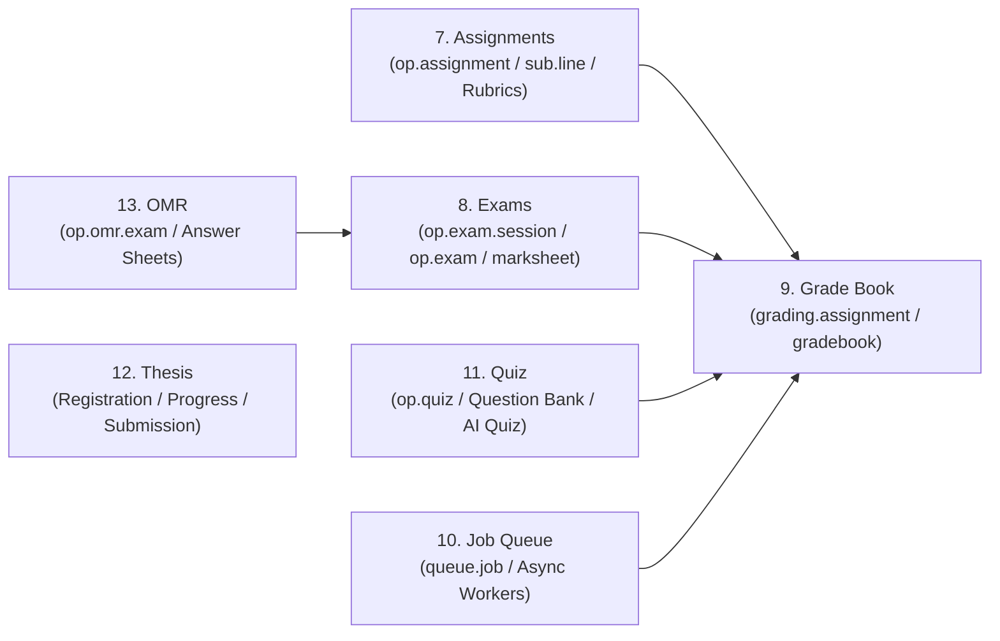

# 03 — Assessment, Grading, Research & Queue Modules (Modules 7–13)

> **Source Instance:** `https://21058239.o19.oeducat.org` (Odoo 19 Enterprise / OpenEduCat SaaS)  
> **Target Client Context:** **Oshwal Academy Nairobi** (`https://oan.oshwalacademy.sc.ke/academics/`)  
> **Verification Status:** 100% Live DOM & Network Verified (Zero Hallucination)

---

## Architecture Overview (Modules 7–13)

---

## Module 7: Assignments (`openeducat_assignment.menu_op_assignment_root`)

### 7.1 Complete Navigation & Action Hierarchy

| Menu Path | Label | Route / Action | XML ID | Target Model | View Modes |
|---|---|---|---|---|---|
| `Assignments > Assignments` | Assignments | `/openeducat/assignment` | `openeducat_assignment.menu_op_assignment_sub` | `op.assignment` | List, Pivot, Graph, Form |
| `Assignments > Submissions` | Submissions | `/openeducat/assignment-sub-line` | `openeducat_assignment.menu_op_assignment_sub_line_sub` | `op.assignment.sub.line` | List, Form |
| `Reporting > Assignment Analysis` | Assignment Analysis | `/openeducat/assignment-analysis` | `openeducat_assignment_enterprise.menu_op_assignment_analysis` | `op.assignment` | Pivot, Graph |
| `Reporting > Submission Analysis` | Submission Analysis | `/openeducat/assignment-sub-line-analysis` | `openeducat_assignment_enterprise.menu_op_assignment_submission_analysis` | `op.assignment.sub.line` | Pivot, Graph |
| `Configuration > Settings` | Settings | `/openeducat/res-config-settings` | `openeducat_assignment.menu_assignment_config` | `res.config.settings` | Form |
| `Configuration > Assignment Types` | Assignment Types | `/openeducat/grading-assignment-type` | `openeducat_assignment.menu_op_assignment_type_sub` | `grading.assignment.type` | List, Form |
| `Configuration > Rubrics Template` | Rubrics Template | `/openeducat/rubric-template` | `openeducat_assignment_rubrics.menu_op_rubric_template_config` | `op.rubric.template` | List, Form |
| `Configuration > Assignment Grades` | Assignment Grades | `/openeducat/assign-grade-config` | `openeducat_assignment_grading_enterprise.menu_op_assign_grade_config` | `op.assign.grade.config` | List, Form |
| `Configuration > Rubrics Level` | Rubrics Level | `/openeducat/rubric-level` | `openeducat_assignment_rubrics.menu_op_rubric_level` | `op.rubric.level` | List, Form |
| `Configuration > Late Submission` | Late Submission | `/openeducat/late-submission` | `openeducat_assignment_grading_bridge.menu_late_submission` | `late.submission` | List, Form |

### 7.2 Assignment Form (`op.assignment`)
- **List Columns (`/openeducat/assignment`):** `Name`, `Course`, `Batch`, `Subject`, `Faculty`, `Assignment Type`, `Issued Date`, `Submission Date`, `Status`, `Company`
- **Form View (`/openeducat/assignment/3` — `BA-Psy-01-Asg-001`):**
  - **Header Action Buttons:** `Publish` (`name="act_publish"`, visible in `Draft` state)
  - **Statusbar Pipeline:** `Draft` → `Published` → `Finished`
  - **Smart Buttons:** `0 Submissions`
  - **Primary Fields:**
    | Technical Name | UI Label | Type | Required | Readonly |
    |---|---|---|---|---|
    | `name` | Assignment Name | `char` | Yes | No |
    | `sequence` | Sequence Code | `char` | Yes | Yes |
    | `course_id` | Course | `many2one` (`op.course`) | Yes | No |
    | `year_id` | Academic Year | `many2one` (`op.academic.year`) | Yes | No |
    | `subject_id` | Subject | `many2one` (`op.subject`) | No | No |
    | `assignment_type` | Assignment Type | `many2one` (`grading.assignment.type`) | Yes | No |
    | `grading_assignment_id` | Grading Assignment | `many2one` (`grading.assignment`) | No | No |
    | `batch_id` | Batch | `many2one` (`op.batch`) | Yes | No |
    | `term_id` | Term | `many2one` (`op.academic.term`) | Yes | No |
    | `faculty_id` | Faculty | `many2one` (`op.faculty`) | Yes | No |
    | `reviewer` | Reviewer | `many2one` (`res.partner`) | No | No |
    | `late_submission_id` | Late Submission Criteria | `many2one` (`late.submission`) | No | No |
    | `company_id` | Company | `many2one` (`res.company`) | No | No |
  - **Notebook Tabs (4):**
    1. **Basic Information:** `attempt_type` (Number of Attempt, `selection`, Req), `grade` (Grade, `many2one`), `issued_date` (`datetime`, Req), `submission_date` (`datetime`, Req), `evaluation_type` (Evolution Type, `selection`, Req), `description` (`text`, Req)
    2. **Student Allocation:** Allocated students list
    3. **Outcome:** OBE Course/Program outcome mapping
    4. **Missing Submissions:** `missing_student_ids`

### 7.3 Assignment Submission Form (`op.assignment.sub.line`)
- **Route:** `/openeducat/assignment-sub-line/new`
- **Header Action Buttons:** `Submit`, `Ignore Attempt`, `Annotate Submission`
- **Statusbar Pipeline:** `Draft` → `Submitted` → `Accepted`
- **Smart Buttons:** `assessment_attempt_line_count` (`statinfo`)
- **Fields:** `student_id` (Student, `many2one`, Req), `assignment_id` (Assignment, `many2one`, Req), `marks` (Given Marks, `float`), `late_submit` (Late Submission, `boolean`, Readonly), `progression_id` (Progression No, `many2one`), `submission_date` (`datetime`, Req), `penalty` (Penalty %, `float`), `obtained_mark` (Obtained Marks, `float`), `company_id` (`many2one`), `description` (`text`), `assessment_attempt_line` (Final Assessment `one2many`, Readonly), `note` (`text`).
- **Configuration Models:**
  - `grading.assignment.type` (8 rows): `Name`, `Code`, `Company`, `Type`
  - `op.rubric.template` (4 rows): `Name`, `Status`, `Company`
  - `op.assign.grade.config` & `op.rubric.level` (6 rows): `Grade`, `Company`
  - `late.submission`: `name` (Req), `late_sub_line` (`one2many`), `company_id`

---

## Module 8: Exams (`openeducat_exam.menu_op_exam_root`)

### 8.1 Complete Navigation & Action Hierarchy

| Menu Path | Label | Route / Action | XML ID | Target Model | View Modes |
|---|---|---|---|---|---|
| `Exams > Exam Sessions` | Exam Sessions | `/openeducat/exam-session` | `openeducat_exam.menu_op_exam_session` | `op.exam.session` | List, Calendar, Pivot, Form |
| `Exams > Exams` | Exams | `/openeducat/exam` | `openeducat_exam.menu_op_exam_main` | `op.exam` | List, Calendar, Pivot, Form |
| `Exams > Exam Attendees` | Exam Attendees | `/openeducat/exam-attendees` | `openeducat_exam.menu_op_exam_attendees_sub` | `op.exam.attendees` | Inline List (`editable="top"`), Pivot |
| `Exams > Result Templates` | Result Templates | `/openeducat/result-template` | `openeducat_exam.menu_op_result_template` | `op.result.template` | List, Form |
| `Exams > Marksheet Registers` | Marksheet Registers | `/openeducat/marksheet-register` | `openeducat_exam.menu_op_marksheet_register_sub` | `op.marksheet.register` | List, Form |
| `Exams > Marksheet Lines` | Marksheet Lines | `/openeducat/marksheet-line` | `openeducat_exam.menu_op_marksheet_line_sub` | `op.marksheet.line` | List, Pivot, Form |
| `Exams > Result Lines` | Result Lines | `/openeducat/result-line` | `openeducat_exam.menu_op_result_line_sub` | `op.result.line` | List, Form |
| `Reporting > Result Analysis` | Result Analysis | `/openeducat/result-analysis` | `openeducat_exam.menu_student_hall_ticket` | `op.result.line` | Graph (Bar/Line/Pie) |
| `Configuration > Settings` | Settings | `/openeducat/res-config-settings` | `openeducat_exam.menu_exam_config` | `res.config.settings` | Form |
| `Configuration > Exam Types` | Exam Types | `/openeducat/exam-type` | `openeducat_exam.menu_op_exam_type_sub` | `op.exam.type` | List, Form |
| `Configuration > Exam Rooms` | Exam Rooms | `/openeducat/exam-room` | `openeducat_exam.menu_op_exam_room_sub` | `op.exam.room` | List, Form |

### 8.2 Exam Session, Exam, Result Template & Marksheet Register Schemas

#### A. Exam Session Form (`op.exam.session`, `/openeducat/exam-session/1`)
- **Header Button:** `Schedule` (in `Draft` state)
- **Statusbar Pipeline:** `Draft` → `Held` → `Done`
- **Smart Button:** `4 Exams` (`exams_count`)
- **Fields:** `name` (Exam Session, Req), `exam_code` (Exam Session Code, Req), `start_date` (Req), `end_date` (Req), `course_id` (Req), `batch_id` (Req), `exam_type` (Req), `evaluation_type` (`selection`, Req), `year_id` (Academic Year, Req), `term_id` (Academic Term, Req), `venue` (`many2one`, Req), `company_id`.

#### B. Exam Form (`op.exam`, `/openeducat/exam/1` — `CC-FPCT-E1`)
- **Header Buttons:** `Schedule Exam` & `Cancel` (in `Draft`), `Done` (in `Result Updated`)
- **Statusbar Pipeline:** `Draft` → `Held` → `Result Updated` → `Done`
- **Smart Button:** `attendees_count` (`Exam Attendees`)
- **Fields:** `name` (Exam, Req), `session_id` (Exam Session, Req), `exam_code` (Req), `total_marks` (Req), `min_marks` (Passing Marks, Req), `subject_id` (Req), `grading_assignment_id` (`many2one`), `start_time` (`datetime`, Req), `end_time` (`datetime`, Req), `faculty_id` (Req), `company_id`, `note` (`text`).

#### C. Result Template Form (`op.result.template`, `/openeducat/result-template/1` — `BCA Template`)
- **Header Button:** `Generate Result`
- **Statusbar Pipeline:** `Draft` → `Result Generated`
- **Fields:** `name` (Req), `exam_session_id` (Req), `company_id`, `result_date` (`date`, Req), `evaluation_type` (`selection`, Readonly).

#### D. Marksheet Register Form (`op.marksheet.register`, `/openeducat/marksheet-register/1`)
- **Statusbar Pipeline:** `Draft` → `Validated` → `Cancelled`
- **Fields:** `name` (Marksheet Register, Req), `generated_by` (`many2one`, Req), `total_pass` (`integer`, Readonly), `total_failed` (`integer`, Readonly), `result_template_id` (Req), `exam_session_id` (Req), `generated_date` (`date`, Req), `company_id`.
- **Embedded Table (`marksheet_line`):** `Student`, `Total Marks`, `Percentage`, `GPA`, `Grade`, `Status`, `Company`, `Evolution Type`.

---

## Module 9: Grade Book (`openeducat_grading.menu_op_grading_root`)

### 9.1 Complete Navigation & Action Hierarchy

| Menu Path | Label | Route / Action | XML ID | Target Model |
|---|---|---|---|---|
| `Grading Assignment` | Grading Assignment | `/openeducat/grading-assignment` | `openeducat_grading.menu_grading_assignment` | `grading.assignment` |
| `Grade Book` | Grade Book | `/openeducat/gradebook-gradebook` | `openeducat_grading.menu_gradebook_gradebook` | `gradebook.gradebook` |
| `Reporting > Gradebook Excel Report` | Gradebook Excel Report | `/openeducat/action-1476` | `openeducat_grading.gradebook_excel_report_menu` | Wizard |
| `Reporting > Grade By Course` | Grade By Course | `/openeducat/courses` | `openeducat_grading.student_progress_grade_book_view_by_course_menu` | `op.course` |
| `Reporting > Grade By Batch` | Grade By Batch | `/openeducat/batches` | `openeducat_grading.student_progress_grade_book_view_by_batch_menu` | `op.batch` |
| `Reporting > Grade By Subject` | Grade By Subject | `/openeducat/subject` | `openeducat_grading.student_progress_grade_book_view_by_subject_menu` | `op.subject` |
| `Reporting > Grades Analysis` | Grades Analysis | `/openeducat/gradebook-line` | `openeducat_grading.grades_analysis` | `gradebook.line` |
| `Reporting > Honor Roll` | Honor Roll | `/openeducat/honorroll` | `openeducat_grading.honor_roll_main` | `op.honor.roll` |
| `Reporting > Grade By Report` | Grade By Report | `/openeducat/action-1495` | `openeducat_grading.student_progress_grade_book_view_by_assignment_menu` | Report |
| `Configuration > Settings` | Settings | `/openeducat/res-config-settings` | `openeducat_grading.menu_grading_config` | `res.config.settings` |
| `Configuration > Assignment Stages` | Assignment Stages | `/openeducat/action-1501` | `openeducat_grading.assignment_stage_menu` | `grading.assignment.stage` |
| `Configuration > Assignment Types` | Assignment Types | `/openeducat/grading-assignment-type` | `openeducat_grading.menu_op_assignment_type` | `grading.assignment.type` |
| `Configuration > Grade Table` | Grade Table | `/openeducat/grade-table` | `openeducat_grading.menu_grade_table` | `op.grade.table` |
| `Configuration > Grade Scale` | Grade Scale | `/openeducat/grade-scale` | `openeducat_grading.menu_grade_scale` | `op.grade.scale` |
| `Configuration > Grade Template` | Grade Template | `/openeducat/grade-template` | `openeducat_grading.menu_grade_template` | `op.grade.template` |

### 9.2 Grading Assignment, Grade Book & Grade Scale Forms
- **Grading Assignment (`grading.assignment`, `/openeducat/grading-assignment/6` — `Essay On Horse`):**
  - **Kanban Stages (6):** `Draft` → `Published` → `Grading Started` → `Grading Closed` → `Grades Published` → `Cancelled`
  - **Header Button:** `Close`
  - **Fields:** `sequence` (Index, Req, Readonly), `name` (Req), `user_id` (Req), `year_id` (Req), `course_id` (Req), `grade`, `company_id`, `issued_date` (`datetime`, Req), `assignment_type` (Req), `faculty_id` (Req), `term_id` (Req), `subject_id` (Req), `point` (Points, `float`).
- **Grade Book Form (`gradebook.gradebook`, `/openeducat/gradebook-gradebook/1` — `GB01`):**
  - **Header Buttons:** `Recompute`, `Cancel`
  - **Statusbar Pipeline:** `Draft` → `In Progress` → `Publish` → `Cancelled`
  - **Fields:** `name` (Req, Readonly), `course_id` (Req, Readonly), `report_type` (`selection`, Readonly), `student_id` (Req, Readonly), `academic_year_id` (`many2many_tags`, Req), `company_id`, `percentage` (`float`, Readonly), `grade` (`char`, Readonly).
  - **Embedded Tables:**
    - `gradebook_line_id` (`Course`, `Term`, `Subject`, `Assignment`, `Assignment Type`)
    - `grade_override` (Final Grades: `Year`, `Terms`, `Subject`, `Assignment`, `Calculated`, `Grade`, `Override`, `Final`, `Comment`)
- **Grade Scale Form (`op.grade.scale`, `/openeducat/grade-scale/1` — `Letter Grades`):**
  - **Statusbar Pipeline:** `Draft` → `Active` (with `Draft` reset button)
  - **Fields:** `name` (Req), `company_id`, `op_grade_type_ids` (`one2many` table: `Name`, `GPA`, `Minimum Percentage`, `Maximum Percentage`, `Company`).
- **Grade Template Form (`op.grade.template`, `/openeducat/grade-template/1` — `Semester Template`):**
  - **Statusbar Pipeline:** `Draft` → `Active`
  - **Fields:** `name` (Req), `company_id`, `template_line_ids` (`one2many`: `Academic Year`, `Terms`, `Weightage Type`, `Company`).

---

## Module 10: Job Queue (`queue_job.menu_queue_job_root`)

| Menu Path | Label | Route / Action | Target Model | View Modes / Columns |
|---|---|---|---|---|
| `Queue > Jobs` | Jobs | `/openeducat/action-246` | `queue.job` | List, Pivot, Graph — Columns: `Description`, `Model`, `State`, `Created Date`, `Date Done`, `Execution Time (avg)`, `UUID`, `Channel`, `Company` |
| `Queue > Channels` | Channels | `/openeducat/action-247` | `queue.job.channel` | List (`Complete Name`) |
| `Queue > Job Functions` | Job Functions | `/openeducat/action-248` | `queue.job.function` | List (`Name`, `Channel`, `Allow Commit`) |

---

## Module 11: Quiz (`openeducat_quiz.op_quiz_main_menu`)

### 11.1 Complete Navigation & Action Hierarchy

| Menu Path | Label | Route / Action | XML ID | Target Model |
|---|---|---|---|---|
| `Quiz > Quiz` | Quiz | `/openeducat/quiz` | `openeducat_quiz.menu_op_quiz` | `op.quiz` |
| `Quiz > Results` | Results | `/openeducat/quiz-result` | `openeducat_quiz.menu_op_quiz_result` | `op.quiz.result` |
| `Question Bank > Question Bank` | Question Bank | `/openeducat/action-1254` | `openeducat_quiz.menu_op_question_bank` | `op.question.bank` |
| `Reporting > Quiz Result Analysis` | Quiz Result Analysis | `/openeducat/action-1253` | `openeducat_quiz.menu_op_quiz_analysis` | `op.quiz.result` |
| `Configuration > Settings` | Settings | `/openeducat/res-config-settings` | `openeducat_quiz.menu_quiz_config` | `res.config.settings` |
| `Configuration > Quiz Category` | Quiz Category | `/openeducat/quiz-category` | `openeducat_quiz.menu_op_quiz_category` | `op.quiz.category` |
| `Configuration > Grades` | Grades | `/openeducat/action-1250` | `openeducat_quiz.menu_op_answer_grade` | `op.answer.grade` |
| `Configuration > Question Bank Type` | Question Bank Type | `/openeducat/question-bank-type` | `openeducat_quiz.menu_op_question_bank_type` | `op.question.bank.type` |
| `AI Quiz Generator` | AI Quiz Generator | `/openeducat/action-1334` | `openeducat_ai_quiz.op_quiz_ai_menu` | OWL AI Client |

### 11.2 Quiz, Question Bank & Quiz Result Forms
- **Quiz Form (`op.quiz`, `/openeducat/quiz/1` — `Quiz Round 1`):**
  - **Header Button:** `Confirm`
  - **Statusbar Pipeline:** `Draft` → `In-Progress` → `Done` → `Cancel`
  - **Fields:** `name` (Req), `quiz_config` (`selection`, Req), `company_id`, `parent_id` (Parent Quiz), `assigned_to` (`selection`, Req), `categ_id` (Category, Req), `total_marks` (`float`, Readonly), `lms` (`boolean`).
  - **Notebook Tabs (6):**
    1. **Questions:** `line_ids` (`sequence`, `Question`, `Question Type`, `Marks`, `Company`)
    2. **Result Message:** `Result From (%)`, `Result To (%)`, `Company`
    3. **Configuration:** Anti-cheating & proctoring toggles (`Single Question Per Page`, `Previous Question Allowed`, `Only One Time Answer`, `Show Header`, `Allow Shuffle?`, `Allow Attached Reference Material`, `No of Attempt`, `All Question are Required`, `Allow Exit`, `Manual`, `Display Result?`, `Display On Portal`, `Time Configuration`, `Time Limit`, `Hr`, `Min`, `Face Tracking`, `Copy/Paste Allow`, `Question Time Out`, `In Minutes`, `Take Screenshot`)
    4. **Starting Page:** `Starting View`
    5. **Description**
    6. **Challenges**
- **Question Bank Form (`op.question.bank`, `/openeducat/action-1254/1` — `Std-5 Math Test`):**
  - **Fields:** `name` (Req), `bank_type_id` (Type, Req), `company_id`; tabs `Questions` (`line_ids`: `Question`, `Question Type`, `Marks`, `Company`) and `Description`.
- **Quiz Result Form (`op.quiz.result`, `/openeducat/quiz-result/1`):**
  - **Header Button:** `Submit`
  - **Statusbar Pipeline:** `In-Progress` → `Hold` → `Submit` → `To Asses` → `Done`
  - **Fields:** `index`, `name`, `user_id`, `quiz_id`, `categ_id`, `total_marks`, `received_marks`, `score` (Score %), `Submitted On`, `company_id`, `total_question`, `total_correct`, `total_incorrect`, `Finished On`, plus `line_ids` (per-question breakdown) and `warning_line_ids` (proctoring warnings & screenshot attachments).

---

## Module 12: Thesis (`openeducat_thesis.menu_op_thesis_root`)

### 12.1 Complete Navigation & Action Hierarchy

| Menu Path | Label | Route / Action | XML ID | Target Model |
|---|---|---|---|---|
| `Thesis Management > Registrations` | Registrations | `/openeducat/thesis-registration` | `openeducat_thesis.menu_op_thesis_registration` | `op.thesis.registration` |
| `Thesis Management > Progress Reports` | Progress Reports | `/openeducat/progress-reports` | `openeducat_thesis.menu_op_thesis_progress` | `op.thesis.progress` |
| `Thesis Management > Extension Requests` | Extension Requests | `/openeducat/extension-requests` | `openeducat_thesis.menu_op_thesis_extension` | `op.thesis.extension` |
| `Thesis Management > Submissions` | Submissions | `/openeducat/thesis-submission` | `openeducat_thesis.menu_op_thesis_submission` | `op.thesis.submission` |
| `Configuration > Committee Members` | Committee Members | `/openeducat/thesis-committee` | `openeducat_thesis.menu_op_thesis_committee` | `op.thesis.committee` |
| `Configuration > Evaluation Templates` | Evaluation Templates | `/openeducat/thesis-evaluations-template` | `openeducat_thesis.menu_op_thesis_evaluation_template` | `op.thesis.evaluation.template` |
| `Configuration > Extension Reasons` | Extension Reasons | `/openeducat/extension-reasons` | `openeducat_thesis.menu_op_thesis_extension_reason` | `op.thesis.extension.reason` |
| `Configuration > Report Types` | Report Types | `/openeducat/report-types` | `openeducat_thesis.menu_op_thesis_report_type` | `op.thesis.report.type` |

### 12.2 Thesis Registration, Extension & Submission Forms
- **Thesis Registration (`op.thesis.registration`, `/openeducat/thesis-registration/2`):**
  - **Header Buttons:** `Start Research`, `Add Committee Member`
  - **Statusbar Pipeline:** `Draft` → `Submitted` → `Approved` → `In Progress` → `Completed`
  - **Fields:** `code` (Readonly), `name` (Title, Req), `student_id` (Req), `program_id` (Req), `department_id`, `research_area` (Req), `registration_date`, `program_duration_months` (Thesis Duration months), `default_submission_deadline`, `final_submission_deadline`, `committee_ids`.
  - **Notebook Tabs (3):** `Committee Members` (`Faculty Member`, `Role`, `Email`, `Phone`), `Progress Reports`, `Extension Requests`.
- **Thesis Extension Request (`op.thesis.extension`, `/openeducat/extension-requests/2`):**
  - **Header Button:** `Submit`
  - **Statusbar Pipeline:** `Draft` → `Submitted` → `Supervisor Review` → `HoD Review` → `Approved` → `Rejected`
  - **Fields:** `name`, `registration_id` (Req), `student_id`, `request_date` (Req), `current_deadline`, `requested_deadline` (Req), `extension_duration` (Extension Days), `reason_id` (Req), `supervisor_id`, `reason_details` (Req).
- **Thesis Submission (`op.thesis.submission`, `/openeducat/thesis-submission/1` — `THS/2026/0001`):**
  - **Header Buttons:** `Start Review`, `Invite Examiner`
  - **Statusbar Pipeline:** `Draft` → `Submitted` → `Under Review` → `Approved` → `Evaluated` → `Completed`
  - **Fields:** `name`, `title` (Final Title, Req), `registration_id` (Req), `student_id`, `submission_date`, `total_score`, `examiner_id`, `thesis_file` (Req).
  - **Notebook Tabs (3):** `Thesis Document`, `Additional Document`, `Revision Comments`.

---

## Module 13: OMR — Optical Mark Recognition (`openeducat_omr.menu_action_omr_root`)

### 13.1 Complete Navigation & Action Hierarchy

| Menu Path | Label | Route / Action | XML ID | Target Model |
|---|---|---|---|---|
| `Exam` | Exam | `/openeducat/omr_exam` | `openeducat_omr.menu_action_omr_exam_list` | `op.omr.exam` |
| `Generate Sheet` | Generate Sheet | `/openeducat/action-1390` | `openeducat_omr.menu_action_temp_omr` | `op.omr.template.wizard` (Modal) |
| `Configuration > Settings` | Settings | `/openeducat/res-config-settings` | `openeducat_omr.menu_omr_config` | `res.config.settings` |
| `Configuration > Answer Sheet` | Answer Sheet | `/openeducat/answer_configuration` | `openeducat_omr.menu_action_answersheet_configuration_list` | `op.answersheet.configuration` |

### 13.2 OMR Exam, Sheet Generator & Answer Key Schemas
- **OMR Exam Form (`op.omr.exam`, `/openeducat/omr_exam/1` — `EXAM0001`):**
  - **Header Buttons:** `Scan`, `Upload`, `Done`, `Cancel`
  - **Statusbar Pipeline:** `Draft` → `Confirm` → `Done` / `Cancel`
  - **Smart Button:** `3 Answer Sheets`
  - **Fields:** `name` (Exam Name, Req), `subject_id` (Req), `is_student_upload_omr` (Allow Student to Upload OMR, `boolean`), `template_id` (Template, Req), `answersheet_configuration_id` (Answer Sheet, Req), `display_result` (Display OMR Result To Student, `boolean`).
  - **Notebook Tab (`Student Answers Detail`):** `answer_sheets_line` (`Roll Number`, `Paper Set`, `Right Answers`, `Wrong Answer`, `Not Attampted`, `Total Score`, `Student`).
- **Generate Sheet Wizard (`op.omr.template.wizard`, `/openeducat/action-1390`):**
  - **Fields:** `no_option` (No of Options), `no_que` (No of Questions), `date`, `mobile_no`, `instruction` (Instruction Block), `signature` (Signature Block), `batch` (Batch Field); buttons `Print` and `Cancel`.
- **Answer Sheet Configuration (`op.answersheet.configuration`, `/openeducat/answer_configuration/1`):**
  - **Fields:** `name` (Req), `company_id`, `subject_id` (Req); tab `Answer Keys` (`op.answer.set` rows for Paper Sets A–E).

