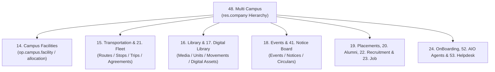
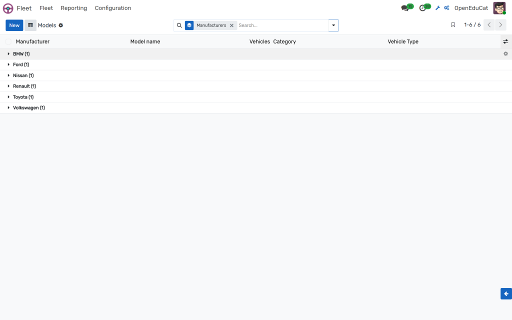
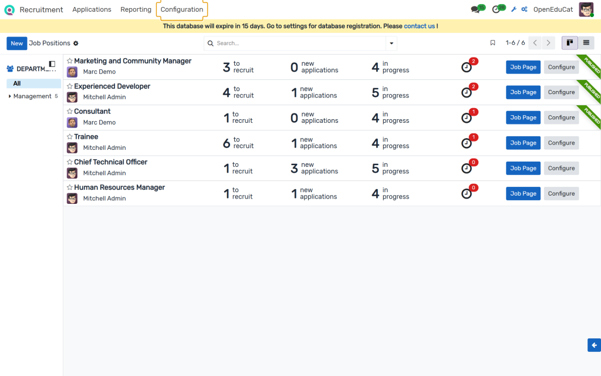

# 04 — Campus, Library, Transport, Career, Alumni, AI & Support Modules

> **Source Instance:** `https://21058239.o19.oeducat.org` (Odoo 19 Enterprise / OpenEduCat SaaS)  
> **Target Client Context:** **Oshwal Academy Nairobi** (`https://oan.oshwalacademy.sc.ke/academics/`)  
> **Modules Covered:** Modules 14 (`Campus`), 48 (`Multi Campus`), 15 (`Transportation`), 21 (`Fleet`), 16 (`Library`), 17 (`Digital Library`), 18 (`Events`), 19 (`Placements`), 20 (`Alumni`), 22 (`Recruitment`), 23 (`Job`), 24 (`OnBoarding`), 41 (`Notice Board`), 52 (`AIO`), 53 (`Helpdesk`)

---

## Architecture Overview

---

## Module 14: Campus (`openeducat_campus_enterprise.menu_campus_management`) & Module 48: Multi Campus (`openeducat_multi_location_enterprise.menu_main_multi_location`)

### 14.1 Complete Navigation & Action Hierarchy

| Module | Menu Path | Label | Route / Action | XML ID | Target Model |
|---|---|---|---|---|---|
| `Campus` | `Facilities > Facility` | Facility | `/openeducat/campus-facility` | `openeducat_campus_enterprise.menu_all_facility` | `op.campus.facility` |
| `Campus` | `Facilities > Facility Allocations` | Facility Allocations | `/openeducat/facility-allocation` | `openeducat_campus_enterprise.menu_op_hostel_room_sub` | `op.facility.allocation` |
| `Campus` | `Configuration > Settings` | Settings | `/openeducat/res-config-settings` | `openeducat_campus_enterprise.menu_op_hostel_configuration_sub` | `res.config.settings` |
| `Campus` | `Configuration > Facility Type` | Facility Type | `/openeducat/facility-type` | — | `op.facility.type` |
| `Multi Campus` | `Dashboard` | Dashboard | `/openeducat/action-1231` | `openeducat_multi_location_enterprise.menu_op_multy_location` | `res.company` |

### 14.2 Campus Facility & Allocation Forms
- **Facility Form (`op.campus.facility`, `/openeducat/campus-facility/1` — `Boys Hostel`):**
  - **Search Panel Facets:** `Facility Type` (`All`, `Hostel`, `Ground`, `Hall`, `Garden`)
  - **Smart Button:** `Allocations`
  - **Fields:** `name` (`char`, Req), `facility_type_id` (`many2one`, Req), `parent_id` (`many2one` Parent Facility), `company_id` (`many2one`), `capacity` (`integer`), `code` (`char`, Req).
  - **Notebook Tabs (2):**
    1. **Sub Facilities (`child_ids`):** `Name`, `Parent Facility`, `Facility Type`, `Capacity`, `Company`
    2. **Facility Allocation (`facility_allocation_lines`):** `Person`, `Facility`, `Product`, `From Date`, `To Date`, `Company`
- **Facility Allocation Form (`op.facility.allocation`, `/openeducat/facility-allocation/1` — `Alex J Parker`):**
  - **Header Button:** `Create Invoice`
  - **Fields:** `partner_id` (Person, Req), `facility_id` (Facility, Req), `product_id` (Product/Fee Item, Req), `from_date` (`datetime`, Req), `to_date` (`datetime`, Req), `company_id`.
- **Multi Campus Dashboard (`res.company`, `/openeducat/action-1231`):**
  - Kanban cards displaying active campuses (`OpenEduCat`, `My US Company`, `My Company (Chicago)`, `Campus 2`) with counters for `Sub Locations`, `Students`, `Courses`, `Subjects`, `Batches`, and `View Location` drill-down button.
  - **Campus / Company Form (`/openeducat/action-1231/res.company/new`):** Fields `logo`, `name` (Req), `street`, `street2`, `city`, `state_id`, `zip`, `country_id`, `vat`, `company_registry`, `currency_id` (Req), `phone`, `email`, `website`, `signature`, `alias_domain_id`, `color`; Notebook tabs: `General Information`, `Branches`, `Exchange Rate Orchestration`, `Board Affiliation`, `Institute Detail`.

---

## Module 15: Transportation (`openeducat_transportation_enterprise.menu_op_transportations_main`) & Module 21: Fleet (`fleet.menu_root`)

### 15.1 Complete Navigation & Action Hierarchy

| Module | Menu Path | Label | Route / Action | XML ID | Target Model |
|---|---|---|---|---|---|
| `Transportation` | `Route Register` | Route Register | `/openeducat/route-register` | `openeducat_transportation_enterprise.menu_op_route_register_sub` | `op.route.register` |
| `Transportation` | `Trips` | Trips | `/openeducat/route-line` | `openeducat_transportation_enterprise.menu_op_route_line_sub` | `op.route.line` |
| `Transportation` | `Agreements` | Agreements | `/openeducat/transportation-agreement` | `openeducat_transportation_enterprise.menu_op_transport_agreement_sub` | `op.transportation.agreement` |
| `Transportation` | `Reporting > Trips Analysis` | Trips Analysis | `/openeducat/action-1300` | `openeducat_transportation_enterprise.id_trips_analysis` | `op.route.line` |
| `Transportation` | `Configuration > Settings` | Settings | `/openeducat/res-config-settings` | `openeducat_transportation_enterprise.menu_transportations__config` | `res.config.settings` |
| `Transportation` | `Configuration > Routes` | Routes | `/openeducat/route` | `openeducat_transportation_enterprise.menu_op_route_sub` | `op.route` |
| `Transportation` | `Configuration > Stops` | Stops | `/openeducat/stop` | `openeducat_transportation_enterprise.menu_op_stop_sub` | `op.stop` |
| `Transportation` | `Configuration > Vehicles` | Vehicles | `/openeducat/vehicle` | `openeducat_transportation_enterprise.menu_op_vehicle_sub` | `fleet.vehicle` |
| `Transportation` | `Configuration > Plan` | Plan | `/openeducat/cost-plan` | `openeducat_transportation_enterprise.menu_op_cost_plan_sub` | `op.cost.plan` |
| `Fleet` | `Fleet > Fleet` | Fleet | `/openeducat/fleet` | `fleet.fleet_vehicle_menu` | `fleet.vehicle` |
| `Fleet` | `Fleet > Contracts` | Contracts | `/openeducat/action-190` | `fleet.fleet_vehicle_log_contract_menu` | `fleet.vehicle.log.contract` |
| `Fleet` | `Fleet > Services` | Services | `/openeducat/action-191` | `fleet.fleet_vehicle_log_services_menu` | `fleet.vehicle.log.services` |
| `Fleet` | `Fleet > Odometers` | Odometers | `/openeducat/action-185` | `fleet.fleet_vehicle_odometer_menu` | `fleet.vehicle.odometer` |
| `Fleet` | `Reporting > Costs / Odometers` | Costs / Odometers | `/openeducat/action-192`, `action-195` | `fleet.menu_fleet_reporting_*` | Pivot / Graph |
| `Fleet` | `Configuration > Settings / Manufacturers / Models / Categories` | Config | `/openeducat/action-194`, `182`, `181`, `183` | `fleet.*` | List, Form |

### 15.2 Transportation & Fleet Schemas
- **Route Register Form (`op.route.register`, `/openeducat/route-register/1`):**
  - **Header Buttons:** `Confirm`, `Cancel`
  - **Statusbar Pipeline:** `Draft` → `Confirm` → `Register Gathering` → `Cancel`
  - **Fields:** `name` (Req), `start_date` (`date`, Req), `end_date` (`date`, Req), `product_id` (Req), `plan_id`, `route_id` (Req), `cost` (`float`), plus tab `Agreement Applicants` (`transport_lines`: `Student/Faculty`, `Stop`, `Agreement Date`, `State`).
- **Trip Form (`op.route.line`, `/openeducat/route-line/1`):**
  - **Header Button:** `Start Trip`
  - **Statusbar Pipeline:** `Draft` → `Start` → `End`
  - **Fields:** `name`, `route_type` (`selection`: Pickup/Drop, Req), `route_date` (`date`, Req), `company_id`, `route_id` (Req), `start_time` (`float`, Req), `driver_id` (Req); tabs `Stops` (`Sequence`, `Stop`, `Estimated Arrival`) and `Passengers` (`Passenger`, `Present/Absent`, `Stop`, `Company`).
- **Transportation Agreement Form (`op.transportation.agreement`, `/openeducat/transportation-agreement/1`):**
  - **Statusbar Pipeline:** `Draft` → `Confirmed` → `Done` (with `Cancel` button)
  - **Fields:** `partner_id` (Student/Faculty, Req), `route_id` (Req), `plan_id`, `date` (Agreement Date, Req), `prev_invoice_date`, `company_id`, `route_register_id` (Req), `stop_id` (Req), `expires_after`, `end_date`, `next_invoice_date`, `bill`, `bill_selection`; tab `Transportation Fees Collection` (`transportation_fees_detail_ids`).
- **Fleet Vehicle Form (`fleet.vehicle`, `/openeducat/fleet/6` — `BMW/Bus/6DG8523`):**
  - **Smart Buttons (4):** `1 Drivers History`, `0 Contracts`, `0 Services`, `0 Odometer`
  - **Fields:** `image_128`, `model_id` (Req), `license_plate`, `tag_ids`, `driver_id`, `future_driver_id`, `next_assignation_date`, `company_id`, `category_id`, `order_date`, `acquisition_date`, `write_off_date`, `vin_sn`, `odometer`, `odometer_unit` (Req), `manager_id`, `location`, `plan_to_change_car`; tabs `Tax Info`, `Model`, `Note`.

---

## Module 16: Library (`openeducat_library.menu_op_library_root`) & Module 17: Digital Library (`openeducat_digital_library.menu_op_digital_library_main_root`)

### 16.1 Complete Navigation & Action Hierarchy

| Module | Menu Path | Label | Route / Action | XML ID | Target Model |
|---|---|---|---|---|---|
| `Library` | `Dashboard` | Dashboard | `/openeducat/media-type-dashboard` | `openeducat_library_enterprise.menu_op_dashboard_librarian` | `op.media.type` |
| `Library` | `All Media > Media` | Media | `/openeducat/media` | `openeducat_library.menu_op_sub_media_library` | `op.media` |
| `Library` | `All Media > Media Units` | Media Units | `/openeducat/media-unit` | `openeducat_library.menu_op_media_unit_library` | `op.media.unit` |
| `Library` | `All Media > Media Movements` | Media Movements | `/openeducat/media-movement` | `openeducat_library.menu_op_media_movement_library` | `op.media.movement` |
| `Library` | `All Media > Media Queue Requests` | Media Queue Requests | `/openeducat/media-queue` | `openeducat_library.menu_op_media_queue_request_library_sub` | `op.media.queue` |
| `Library` | `All Media > Media Purchase Requests` | Media Purchase Requests | `/openeducat/media-purchase` | `openeducat_library.menu_op_media_request_library_sub` | `op.media.purchase` |
| `Library` | `All Media > Issue Media` | Issue Media | `/openeducat/action-1207` | `openeducat_library_enterprise.barcode_issue_media_menu` | Barcode Issue |
| `Library` | `Barcode` | Barcode | `/openeducat/action-1206` | `openeducat_library_barcode.menu_library_barcode_scan` | Barcode Kiosk |
| `Library` | `Reporting > Media / Unit / Movement / Queue / Purchase Analysis` | 5 Reports | `/openeducat/media-*-reporting` | `openeducat_library_enterprise.*` | Pivot / Graph |
| `Library` | `Configuration > Settings / Library Cards / Publishers / Authors / Tags / Media Type / Library Card Types` | Config | `/openeducat/library-card`, `/publisher`, `/author`, `/tag`, `/media-type`, `/action-1138` | `openeducat_library.*` | List, Form |
| `Digital Library` | `Category` | Category | `/openeducat/category` | `openeducat_digital_library.menu_op_digital_library_category` | `op.digital.library.category` |
| `Digital Library` | `Material` | Material | `/openeducat/materials` | `openeducat_digital_library.menu_op_digital_library_material` | `op.digital.library.material` |
| `Digital Library` | `Enrollment` | Enrollment | `/openeducat/library-enrollment` | `openeducat_digital_library.menu_op_digital_library_enrollment` | `op.digital.library.enrollment` |

### 16.2 Library & Digital Library Forms
- **Media Form (`op.media`, `/openeducat/media/4` — `Advanced Accounting`):**
  - **Smart Buttons (3):** `5 Units`, `Movements`, `0 Media Queue Requests`
  - **Fields:** `name` (Title, Req), `author_ids` (`many2many_tags`, Req), `isbn`, `edition`, `media_type_id`, `publisher_ids` (`many2many_tags`, Req), `internal_code`, `tags` (`many2many_tags`), `company_id`.
  - **Notebook Tabs (3):** `Description` (`description`), `Education Details` (`course_ids`, `subject_ids`), `Media Queue Requests` (`queue_ids`).
- **Media Unit Form (`op.media.unit`, `/openeducat/media-unit/12`):**
  - **Header Button:** `Return Media`
  - **Statusbar Pipeline:** `Available` ↔ `Issued`
  - **Fields:** `name` (Req), `barcode` (Readonly), `company_id`, `media_id` (Req), `media_type_id`; tab `Movements` (`movement_lines`).
- **Media Movement Form (`op.media.movement`, `/openeducat/media-movement/8`):**
  - **Header Buttons:** `Return Media`, `Renew Media`
  - **Statusbar Pipeline:** `Issued` → `Available` (Returned)
  - **Fields:** `media_id` (Req), `media_type_id`, `media_unit_id` (Req), `queue_count`, `library_card_id` (Req), `student_id` (Req), `type` (Student/Faculty, Req), `issued_date` (Req), `return_date` (Due Date, Req), `actual_return_date`, `penalty`, `company_id`.
- **Digital Library Material Form (`op.digital.library.material`, `/openeducat/materials/1` — `A New Visitor`):**
  - **Fields:** `name` (Req), `material_cover` (`image`), `material_data` (File/URL, Req), `material_type` (Req), `language_id`, `material_edition` (Req), `publish_online` (`boolean`), `author_ids` (Req), `material_source` (Req), `publisher_ids` (Req), `material_tags`, `rating`, `company_id`, `total_reviews`, `isbn_code`, `material_description` (`html`).
  - **Notebook Tabs (2):** `Enrollments` (`material_enrollment_line`), `Reviews` (`material_review_line`).

---

## Module 18: Events (`event.event_main_menu`) & Module 41: Notice Board (`openeducat_notice_board_enterprise.menu_main_notice_board`)

### 18.1 Events (`event.event`)
- **Sub-Menus:** `Events` (`/openeducat/events`), `Registration Desk` (`/openeducat/registration-desk` barcode scanner), `Reporting > Attendees` (`action-311`), `Reporting > Revenues` (`action-1071`), `Configuration > Settings / Event Templates / Event Stages / Event Tags Categories / Event Questions / Lead Generation`.
- **Event Form (`/openeducat/events/11` — `Conference for Architects`):**
  - **Header Buttons:** `Registration Desk`, `Invite`, `Contact Attendees`
  - **Statusbar Stages:** `New` → `Booked` → `Announced` → `Ended`
  - **Smart Buttons (4):** `Go to Website`, `Registration`, `Attendees (5)`, `Sales ($ 6,325.00)`
  - **Fields (including OpenEduCat extensions):** `Event Name`, `Date`, `Display Timezone`, `Multiple Slots`, `Language`, `Is Convocation` (OpenEduCat boolean), `Template`, `Training Event` (OpenEduCat placement boolean), `Tags`, `Organizer`, `Responsible`, `Company`, `Website`, `Visibility`, `Venue`, `Limit Registrations`; tabs `Tickets`, `Communication`, `Questions`, `Notes & Documents`.

### 18.2 Notice Board (`op.notice` & `op.circular`)
- **Sub-Menus:** `My Notice > Notices` (`/openeducat/notice`), `My Circular > Circulars` (`/openeducat/circular`), `Configuration > Settings`, `Configuration > Groups` (`/openeducat/notice-group`), `Configuration > Circular Types` (`/openeducat/circular-type`).
- **Notice Form (`op.notice`, `/openeducat/notice/1`):**
  - **Header Button:** `Publish` / `Unpublish`
  - **Statusbar Stages:** `Draft` → `In Progress` → `Published` → `Unpublished` / `Canceled`
  - **Fields:** `notice_number` (Readonly), `name` (Req), `created_by`, `created_date`, `group_ids` (`many2many_tags`), `start_date` (Req), `end_date`, `subject` (Req), `academic_year_id` (Req), `academic_term_id` (Req), `high_priority` (`boolean`), `description` (`html`, Req).
- **Circular Form (`op.circular`, `/openeducat/circular/1`):**
  - Same lifecycle and fields as `op.notice` plus `circular_number`, `company_id`, and `circular_type` (`GEN`, `EXM`, `HOL`).

---

## Module 19: Placements (`openeducat_placement_enterprise`), Module 20: Alumni (`openeducat_alumni_enterprise`), Module 22: Recruitment (`hr_recruitment`) & Module 23: Job (`openeducat_job_enterprise`)

### 19.1 Complete Navigation & Action Hierarchy

| Module | Menu Path | Label | Route / Action | Target Model |
|---|---|---|---|---|
| `Placements` | `Opportunities > Job Opportunities` | Job Opportunities | `/openeducat/internship-placement` | `op.activity.announcement` |
| `Placements` | `Opportunities > Student Applications` | Student Applications | `/openeducat/action-1403` | `op.job.applicant` |
| `Placements` | `Opportunities > Placement Offers` | Placement Offers | `/openeducat/placement-offer` | `op.placement.offer` |
| `Placements` | `Campus Events` | Campus Events | `/openeducat/action-1405` | `event.event` |
| `Placements` | `Configuration > Coordination Teams / Partner Companies / Recruitment Sessions / Event Templates / Stages / Tags` | Config | `/openeducat/placement-cell`, `action-1406`, `action-1407` | `op.placement.cell`, `training.season` |
| `Alumni` | `Alumni Group` | Alumni Group | `/openeducat/alumni-group` | `op.alumni.group` |
| `Alumni` | `Alumni Job` | Alumni Job | `/openeducat/action-1466` | `op.job.post` |
| `Alumni` | `Configuration > Settings` | Settings | `/openeducat/res-config-settings` | `res.config.settings` |
| `Recruitment` | `Applications > By Job Positions / By Talent Pools / All Applications` | Applications | `/openeducat/recruitment`, `/talent-pool`, `/recruitment-applications` | `hr.job`, `hr.applicant` |
| `Job` | `Job Post` | Job Post | `/openeducat/job-post` | `op.job.post` |
| `Job` | `Applicant` | Applicant | `/openeducat/job-applicant` | `op.job.applicant` |
| `Job` | `Configuration > Job Type / Stages` | Config | `/openeducat/job-type`, `/job-post-stage` | `op.job.type`, `job.post.stage` |

### 19.2 Key Schemas
- **Placement Job Opportunity (`op.activity.announcement`, `/openeducat/internship-placement/1`):**
  - **Stages:** `Draft` → `Confirm` → `Published` → `Unpublished`
  - **Fields:** `seq`, `name` (Req), `job_post_id` (Req), `team_id` (Coordination Team), `process` (Req), `opportunity_type` (Req), `experience` (Req), `partner_id` (Partner Company, Req), `skill_id` (Req), `season_id` (Recruitment Session, Req), `start_date` (Req), `end_date` (Req), `written_test`, `group_discussion`, `company_id`, `description`.
- **Placement Offer (`op.placement.offer`, `/openeducat/placement-offer/1`):**
  - **Header Buttons:** `Join`, `Reject`, `Cancel`; **Stages:** `Draft` → `Offer` → `Join`
  - **Fields:** `partner_id` (Partner Company, Req), `student_id` (Student, Req), `join_date`, `offer_package`, `training_period` (Req), `training_type`, `company_id`.
- **Alumni Group (`op.alumni.group`, `/openeducat/alumni-group/1`):**
  - **Header Button:** `Create Forum`
  - **Fields:** `image`, `name` (Req), `company_id`, `fees_id`, `alumni_fees_amount`, `alumni_student_line`, `description`, `blog_post_ids`.
- **Job Post (`op.job.post`, `/openeducat/job-post/1` — `Application Engineer`):**
  - **Header Buttons:** `Stop Recruitment`, `Cancel Recruitment`
  - **Stages:** `Not Recruiting` → `Recruitment in Progress` → `Cancel`
  - **Fields:** `name`, `job_post`, Address block, `description`; tabs `Offer` (`salary_from`, `salary_upto`, `payable_at`, `employment_type`, `skill_ids`, `url`) and `Other Information` (`created_by`, `start_date`, `end_date`, `expected_employees`, `company_id`, `department_id`).

---

## Module 24: OnBoarding (`openeducat_onboarding.menu_op_onboarding_root`)
- **Route:** `/openeducat/onboarding-steps` (`oe.onboarding.steps`)
- **Structure:** Interactive 14-card setup wizard for rapid school ERP implementation:
  1. `Academic Year`
  2. `Academic Term`
  3. `Course`
  4. `Batch`
  5. `Subject`
  6. `Class Room`
  7. `Facilities`
  8. `Quiz Category`
  9. `Achievement Types`
  10. `Activity Types`
  11. `Assignment Types`
  12. `Exam Types`
  13. `Attendance Types`
  14. `Fees Plan`

---

## Module 52: AIO — AI Orchestration & Agents (`aio_agents.menu_aio_root`)
- **Sub-Menu Hierarchy:**
  - `Playground`: `Playground` (`/openeducat/action-888` interactive chat), `Messages` (`action-891`), `Sessions` (`action-890`), `Session Tags` (`action-889`), `Session Analytics` (`action-892`), `Agent Performance` (`action-893`), `Cost Optimization` (`action-894`), `Student Engagement` (`action-895`), `Token Trends` (`action-896`).
  - `Agents`: `Agent Library` (`action-691` — **80 prebuilt AI agents**), `Agents` (`action-670`), `Team Analytics` (`action-681`).
  - `Executions`: `Executions` (`action-671`).
  - `Configuration`: `Model Providers` (`action-677`), `Models` (`action-676`), `Workflows` (`action-693`), `Executions` (`action-695`), `Steps` (`action-694`), `Hooks` (`action-688`), `Hook Logs` (`action-689`), `Tools` (`action-678`), `Collections` (`action-684`), `Webhook Endpoints` (`action-682`), `Database Configs` (`action-683`), `Guardrails` (`action-686`), `File Sources` (`action-685`), `JSON Schemas` (`action-679`), `Output Templates` (`action-680`), `Evaluations` (`action-698`), `Tool Approvals` (`action-696`).
- **Agent Form (`aio.agent.library`, `/openeducat/action-691/91`):**
  - **Header Button:** `Deploy`; **Stages:** `Draft` → `Deployed`
  - **Fields:** `name` (Req), `description`, `icon`, `model_id` (Req), `collection_id`, `vector_store`, `agent_type` (Req), `model_name`, `module_names`, `version`, `last_update`, `structured_output`, `json_schema_id`, `markdown_output`, `is_email_agent`, `available_in_portal`; tabs `Configuration` (`max_retries`, `instructions`), `Tools` (`tool_ids`), `Inputs` (`input_ids`), `Guardrails` (`guardrail_ids`), `Reasoning Configuration`, `Streaming Configuration`.

---

## Module 53: Helpdesk (`helpdesk_basic.helpdesk_basic_root_menu`)
- **Sub-Menu Hierarchy:** `Dashboard` (`/openeducat/helpdesk`), `Tickets > My Tickets` (`/openeducat/my-tickets`), `Tickets > All Tickets` (`/openeducat/all-tickets`), `Reporting > Helpdesk Report` (`/openeducat/helpdesk-report`), `Reporting > Customer Ratings` (`/openeducat/tickets-rating`), `Configuration > Settings / Helpdesk Team / Issue Type / Tags / Stages`.
- **Helpdesk Ticket Form (`helpdesk.ticket`, `/openeducat/my-tickets/1` — `ISSUE0001`):**
  - **Header Buttons:** `Create Opportunity`, `Assign To Me`
  - **Statusbar Pipeline:** `Draft` → `New` → `In Progress` → `Done`
  - **Smart Button:** `1 Open / 1 Tickets`
  - **Fields:** `ticket_seq` (Readonly), `issue_name` (Subject, Req), `user_id` (Assigned To), `partner_id` (Customer), `email`, `priority` (stars), `rating_last_value`, `start_date`, `last_updated_date`, `close_date`, `team_id` (Helpdesk Team, Req), `issue_type_id`, `tag_ids`, and `Description` tab (`help_description`).

