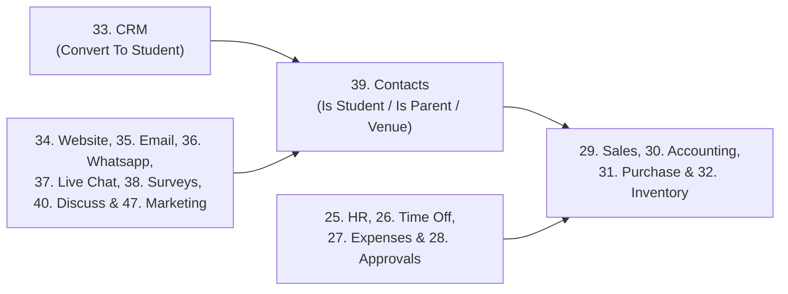
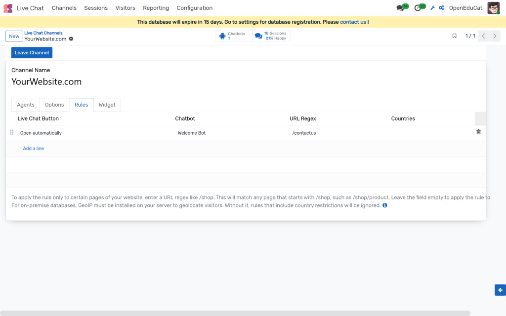

# 05 — HR, Finance, Commercial, CRM, Website & Communication Modules (Modules 25–40 & 47)

> **Source Instance:** `https://21058239.o19.oeducat.org` (Odoo 19 Enterprise / OpenEduCat SaaS)  
> **Target Client Context:** **Oshwal Academy Nairobi** (`https://oan.oshwalacademy.sc.ke/academics/`)  
> **Modules Covered:** Modules 25 (`Human Resources`), 26 (`Time Off`), 27 (`Expenses`), 28 (`Approvals`), 29 (`Sales`), 30 (`Accounting`), 31 (`Purchase`), 32 (`Inventory`), 33 (`CRM`), 34 (`Website`), 35 (`Email Marketing`), 36 (`Whatsapp`), 37 (`Live Chat`), 38 (`Surveys`), 39 (`Contacts`), 40 (`Discuss`), 47 (`Automated Marketing`)

---

## Architecture Overview

---

## Part 1: HR & Staff Administration (Modules 25–28)

### Module 25: Human Resources (`hr.menu_hr_root`)

| Menu Path | Label | Route / Action | XML ID | Target Model |
|---|---|---|---|---|
| `Employees` | Employees | `/openeducat/employees` | `hr.menu_hr_employee_payroll` | `hr.employee` |
| `Departments` | Departments | `/openeducat/departments` | `hr.menu_hr_department_kanban` | `hr.department` |
| `Learning > Certifications` | Certifications | `/openeducat/certifications` | `hr_skills.hr_certification_menu` | `hr.employee.skill` |
| `Learning > Training Attendances` | Training Attendances | `/openeducat/action-829` | `hr_skills.menu_learnings_training_attendances` | Training |
| `Learning > Onsite` | Onsite | `/openeducat/action-912` | `hr_skills_event.menu_learnings_training_attendances_onsite` | Onsite |
| `Reporting > Skills Inventory / Certifications` | Reports | `/openeducat/action-836`, `835` | `hr_skills.*` | Pivot / Matrix |
| `Configuration` | `Settings` (`476`), `Onboarding / Offboarding` (`456`), `Work Locations` (`475`), `Working Schedules` (`101`), `Departure Reasons` (`460`), `Skill Types` (`830`), `Job Positions` (`463`), `Contract Templates` (`459`), `Employment Types` (`461`), `Badges` (`/openeducat/badges`), `Challenges` (`768`), `Goals History` (`767`) | Various | `hr.*`, `gamification.*` | List, Form |

- **Employee Form (`hr.employee`, `/openeducat/employees/6` — `Abigail Peterson`):**
  - **Header Buttons:** `Create User`, `Launch Plan`, `New Employee Record`
  - **Smart Buttons (3):** `Time Off`, `1 Cars History`, `1 History`
  - **Top Identity Fields:** Avatar image, `Employee's Name`, `Work Email`, `Work Phone`, `Work Mobile`, `Tags`
  - **Notebook Tabs (6):**
    1. **Work:** `Company`, `Department`, `Job Position`, `Job Title`, `Manager`, `Location` (`Work Address`, `Work Location`, `Usual Work Location` Mon–Sun), `Note`, `Organization Chart` (`Full Chart`)
    2. **Resume:** `Resume` timeline (`Experience - OpenEduCat`, `Other Experience`, `Education`), `Skills & Certifications` (`Languages`, `Soft Skills`, `Marketing` proficiency bars)
    3. **Certifications:** `Certification`, `From`, `To`
    4. **Personal:** `Private Contact` (`Email`, `Phone`, `Bank Accounts`), `Personal Information` (`Legal Name`, `Birthday`, `Place of Birth`, `Gender`), `Emergency Contact` (`Contact`, `Phone`), `Visa & Work Permit` (`Visa No`, `Work Permit No`, `Document`), `Citizenship` (`Nationality`, `Identification No`, `SSN No`, `Passport No`), `Location` (`Private Address`, `Home-Work Distance`), `Family` (`Marital Status`, `Spouse Legal Name`, `Spouse Birthdate`, `Dependent Children`), `Education` (`Certificate Level`, `Field of Study`), `Documents` (`ID Card Copy`, `Driving License`)
    5. **Payroll:** `Contract Overview` (`Load a Template`, `Contract` date range, `Wage`, `Employee Type`, `Contract Type`, `Pay Category`, `Schedule`, `Working Hours`)
    6. **Settings:** `User` (`Related User`, Timezone), `Approvers` (`HR Responsible`, `Expense`, `Time Off`), `Application Settings` (`Fleet Mobility Card`), `Attendance/Point of Sale` (`PIN Code`, `Badge ID` + `Generate`)

---

### Module 26: Time Off (`hr_holidays.menu_hr_holidays_root`)
- **Sub-Menus:** `My Time > Dashboard` (`/openeducat/time-off`), `My Time > My Time Off` (`/openeducat/my-time-off`), `My Time > My Allocations` (`action-783`), `Overview` (`/openeducat/time-off-overview`), `Management > Time Off` (`/openeducat/time-off-approval`), `Management > Allocations` (`action-786`), `Reporting > by Employee / by Type / Balance` (`action-781`, `791`, `795`), `Configuration > Time Off Types / Accrual Plans / Public Holidays / Mandatory Days` (`action-782`, `787`, `775`, `788`).
- **Time Off Request Form (`hr.leave`, `/openeducat/time-off-approval/12`):**
  - **Header Buttons:** `Approve`, `Validate`, `Refuse`, `Back to Approval`
  - **Statusbar Pipeline:** `To Approve` → `Second Approval` → `Approved`
  - **Fields:** `employee_id` (`Employee`), `company_id`, `department_id`, `holiday_status_id` (`Time Off Type`: Paid Time Off, Sick Time Off, Unpaid, Compensatory Days, Extra Time Off, Extra Hours, Parental Leaves, Training Time Off), `request_date_from` / `Dates`, `duration_display`, `name` (`Description`), `Attach File`.

---

### Module 27: Expenses (`hr_expense.menu_hr_expense_root`)
- **Sub-Menus:** `My Expenses > My Expenses` (`/openeducat/expenses`), `My Expenses > Expenses to Process` (`/openeducat/expenses-to-process`), `Reporting > Expenses Analysis` (`/openeducat/expenses-analysis`), `Configuration > Settings` (`action-765`), `Configuration > Expense Categories` (`action-755`).
- **Expense Form (`hr.expense`, `/openeducat/expenses/4` — `BreakFast`):**
  - **Header Buttons:** `Attach Receipt`, `Submit`, `Split Expense`
  - **Statusbar Pipeline:** `Draft` → `Approved` → `Posted` → `Paid`
  - **Fields:** `name` (`Description`), `product_id` (`Category`), `product_description`, `total_amount_currency` (`Total`), `tax_amount`, `tax_ids` (`Included taxes`), `employee_id`, `payment_mode` (`Paid By`: Employee to reimburse / Company), `date` (`Expense Date`), `company_id`, `manager_id`, `account_id`, `sale_order_id` (`Customer to Reinvoice`), `description`.

---

### Module 28: Approvals (`multi_approval.menu_root`)
- **Sub-Menus:** `Approval Types` (`/openeducat/action-1000`), `Approvals > My Request` (`action-1001`), `Approvals > To Review` (`action-1002`), `Approvals > All Approval` (`action-1003`), `Activity Types` (`action-998`).
- **Approval Type Form (`multi.approval.type`, `/openeducat/action-1000/new`):**
  - **Header Button:** `Create New Request`
  - **Fields:** `image`, `name` (`Approval Type`), `description`, `priority`, `apply_for_model` (`Apply For Model ?`), and `Options` tab with `Required` / `Optional` / `None` radio toggles for `Document`, `Contact`, `Date`, `Period`, `Product`, `Quantity`, `Amount`, `Payment`, `Reference`, `Location`, `Minimum Approvers`, and `line_ids` approver chain (`User`, `Type of Approval`, `Approve Template`, `Reject Template`).
- **Approval Request Form (`multi.request`, `/openeducat/action-1003/new`):**
  - **Header Button:** `Submit`
  - **Statusbar Pipeline:** `To Submit` → `Submitted` → `Approved` / `Refused` / `Cancel`
  - **Fields:** `name` (`Approval Request`), `user_id` (`Request by`), `approval_type_id`, `Date Confirm`, `date`, `company_id`; tabs `Description` (`reason`) and `Approver(s)`.

---

## Part 2: Finance, Fee Invoicing, Procurement & CRM (Modules 29–33)

### Module 29: Sales (`sale.sale_menu_root`)
- **Sub-Menus:** `Orders > Quotations` (`/openeducat/sales`), `Orders > Orders` (`/openeducat/orders`), `Orders > Sales Teams` (`action-255`), `Orders > Customers` (`/openeducat/customers`), `To Invoice > Orders to Invoice` (`action-968`), `To Invoice > Orders to Upsell` (`action-969`), `Products > Products` (`/openeducat/products`), `Products > Product Variants` (`action-226`), `Products > Pricelists` (`/openeducat/pricelists`), `Reporting > Sales / Salespersons / Products / Customers`, `Configuration > Settings / Sales Teams / Quotation Templates / Headers-Footers / Delivery Methods / Tags / Attributes / Combo Choices / Categories / Product Tags / Payment Providers / Payment Methods / Activity Plans`.
- **Sale Order Form (`sale.order`, `/openeducat/sales/7` — `S00007`):**
  - **Header Buttons:** `Create Invoice`, `Send`, `Preview`, `Cancel`
  - **Statusbar Pipeline:** `Quotation` → `Quotation Sent` → `Sales Order`
  - **Fields:** `partner_id` (`Customer`), `partner_invoice_id`, `partner_shipping_id`, `Quotation Template`, `date_order`, `Pricelist`, `payment_term_id`, `note`, `tax_totals`; tabs `Order Lines`, `Quote Builder`, `Other Info`.

---

### Module 30: Accounting (`account.menu_finance`)
- **Sub-Menus:**
  - `Dashboard` (`/openeducat/accounting` — Sales, Purchases, Bank, Expense journals)
  - `Customers`: `Invoices` (`/openeducat/customer-invoices`), `Credit Notes`, `Payments`, `Batch Payments`, `Products`, `Customers`
  - `Vendors`: `Bills`, `Refunds`, `Payments`, `Batch Payments`, `Employee Expenses`, `Products`, `Vendors`
  - `Accounting`: `Transactions` (`Journal Entries`), `Closing` (`Reconcile`, `Lock Dates`), `Assets`, `Generate Assets Entries`
  - `Assets` (**OpenEduCat custom `openeducat_asset_request_enterprise.menu_asset`**): `Request Assets`, `Request Reasons`
  - `Review`: `Control` (`Journal Items`), `Logs` (`Audit Trail`)
  - `Reporting`: `Taxes & Fiscal` (`1099 Report`), `Management` (`Invoice Analysis`, `Analytic Report`, `Assets`)
  - `Configuration`: `Settings`, `Asset Types`, `Chart of Accounts`, `Taxes`, `Journals`, `Currencies`, `Fiscal Positions`, `Multi-Ledger`, `Payment Terms`, `Product Categories`, `Payment Providers`, `Payment Methods`, `Sync Errors`
- **Student / Customer Fee Invoice Form (`account.move`, `/openeducat/customer-invoices/99` — *James M Garcia, Laboratory Fees $9,000.00*):**
  - **Header Buttons:** `Confirm`, `Cancel`
  - **Statusbar Pipeline:** `Draft` → `Posted`
  - **Fields:** `partner_id` (`Customer`), `partner_shipping_id`, `invoice_date`, `invoice_date_due`, `invoice_payment_term_id`, `narration`, `tax_totals`, `amount_residual`.
  - **Notebook Tabs (3):**
    1. **Invoice Lines:** `Product`, `Asset Category` (OpenEduCat asset hook), `Account`, `Quantity`, `Price`, `Taxes`, `Amount`
    2. **Journal Items:** `Asset Category`, `Account`, `Label`, `Debit`, `Credit`, `Tax Grids`
    3. **Other Info:** `Customer Reference`, `Salesperson`, `Sales Team`, `Recipient Bank`, `Payment Reference`, `Delivery Date`, `Company`, `Incoterm`, `Fiscal Position`, `Payment Method`, `Auto-post`, `Reviewed`

---

### Module 31: Purchase (`purchase.menu_purchase_root`) & Module 32: Inventory (`stock.menu_stock_root`)
- **Purchase Order Form (`purchase.order`, `/openeducat/purchase/11` — `P00011`):**
  - **Header Buttons:** `Receive`, `Upload Bill`, `Send PO`, `Acknowledge`, `Print`, `Cancel`
  - **Statusbar Pipeline:** `RFQ` → `RFQ Sent` → `Purchase Order`
  - **Smart Buttons (3):** `Bill Matching`, `Price Comparison`, `1 Receipt`
  - **Fields:** `partner_id` (`Vendor`), `partner_ref`, `date_approve`, `date_planned`, `receipt_reminder_email`, `picking_type_id`, `note`, `tax_totals`; tabs `Products` and `Other Information`.
- **Inventory Transfer Form (`stock.picking`, `/openeducat/receipts/9` — `WH/IN/00002`):**
  - **Header Buttons:** `Validate`, `Print`, `Cancel`
  - **Statusbar Pipeline:** `Draft` → `Ready` → `Done`
  - **Smart Button:** `Moves`
  - **Fields:** `partner_id`, `picking_type_id`, `scheduled_date`, `origin`; tabs `Operations` (`Product`, `Demand`, `Quantity`), `Additional Info`, `Note`.

---

### Module 33: CRM (`crm.crm_menu_root`)
- **Sub-Menus:** `Sales > My Pipeline` (`/openeducat/crm`), `My Activities`, `My Quotations`, `Teams`, `Customers`, `Reporting > Forecast / Pipeline / Leads / Activities`, `Configuration > Settings / Sales Teams / Activity Types / Activity Plans / Tags / Lost Reasons / Lead Mining Requests`.
- **Lead / Opportunity Form (`crm.lead`, `/openeducat/crm/31`):**
  - **Header Buttons:** **`Convert To Student`** *(OpenEduCat CRM-to-Student bridge)*, `New Quotation`, `Won`, `Enrich`, `Lost`
  - **Statusbar Pipeline:** `New` → `Qualified` → `Proposition` → `Won`
  - **Smart Buttons (3):** `No Meeting`, `0 Quotations`, `1 Similar Lead`
  - **Fields:** `name`, `expected_revenue`, `automated_probability`, `probability`, `partner_id`, `email_from`, `phone`, `user_id`, `date_deadline`, `priority`, `tag_ids`, `lead_properties`, `description`; tabs `Notes` and `Contacts`.

---

## Part 3: Website, Marketing & Omnichannel Communication (Modules 34–40 & 47)

### Module 34: Website (`website.menu_website_configuration`)
- **Sub-Menu Hierarchy:**
  - `Site`: `Homepage`, `Menu Editor`, `Content` (`Pages`, `Blog Posts`, `Products`, `Events`, `Jobs`, `Forum Posts`, `Technical Pages`), `This page` (`Properties`, `Optimize SEO`, `Link Tracker`, `HTML / CSS Editor`)
  - `eCommerce`: `Orders` (`Orders`, `Unpaid Orders`, `Abandoned Carts`, `Customers`), `Products` (`Products`, `Pricelists`, `eCommerce Categories`, `Attributes`, `Combo Choices`, `Product Tags`, `Product Ribbons`)
  - `Reporting`: `Analytics`, `Online Sales`, `Visitors`, `Page Views`
  - `Configuration`: `Settings`, `Apps`, `eCommerce` (`Payment Providers`, `Payment Methods`, `Delivery Methods`), `Blog` (`Blogs`, `Tags`, `Tag Categories`), `Forum` (`Forums`, `Ranks`, `Tags`, `Badges`, `Close Reasons`)

---

### Module 35: Email Marketing (`mass_mailing`) & Module 47: Automated Marketing (`automated_marketing`)
- **Email Mailing Form (`mailing.mailing`, `/openeducat/email-marketing/4`):**
  - **Header Buttons:** `Send`, `Schedule`, `Test`, `Add to Templates`
  - **Statusbar Pipeline:** `Draft` → `In Queue` → `Sending` → `Sent`
  - **Fields:** `Subject`, `Recipients` (target model + domain filter); tabs `Mail Body` (drag-and-drop email builder), `A/B Tests`, `Settings`.
- **Marketing Campaign Form (`marketing.campaign`, `/openeducat/marketing-campaign/1` — `Best Offer, 50% off`):**
  - **Header Buttons:** `Open Canvas`, `Start`, `Launch a Test`
  - **Statusbar Pipeline:** `New` → `Running` → `Stopped`
  - **Smart Buttons (3):** `2 Templates`, `0 Clicks`, `15 Participants`
  - **Fields:** `name`, `model_id` (`Target`), `domain` (`Filter`), `marketing_activity_ids` (`Workflow` multi-step automation graph with Email/Server Action nodes and `Sent`/`Clicked`/`Replied`/`Bounced` metrics).

---

### Module 36: Whatsapp (`whatsapp_core.menu_action_whatsapp_root`)
- **Sub-Menu Hierarchy:** `Chat` (`/openeducat/action-1056`), `Contacts` (`whatsapp.contact`), `Campaign > Campaign` (`/openeducat/action-1059`), `Campaign > Trace`, `Campaign > Participants`, `Configuration > Business / Templates / Tags / Templates Library / Server Action / Blocked Contacts / Team Assignment`.
- **Live Chat Workspace (`/openeducat/action-1056`):**
  - Multi-account WhatsApp inbox (`Openeducat WA`) with filter tabs (`All`, `Mine`, `Pinned`, `Spam`, `Archived`), thread list, agent assignment, and message composer.
- **WhatsApp Campaign Form (`whatsapp.campaign`, `/openeducat/action-1059/new`):**
  - **Header Button:** `Start`; **Stages:** `New` → `Running` → `Stopped`
  - **Fields:** `name`, `whatsapp_business_id` (`Business Account`), `model_id` (`Target`), `domain` (`Filter`), `whatsapp_campaign_activity_line` (`Workflow` — `Add new message`).

---

### Module 37: Live Chat (`im_livechat`), Module 38: Surveys (`survey`), Module 39: Contacts (`contacts`) & Module 40: Discuss (`mail`)
- **Live Chat Channel Form (`im_livechat.channel`, `/openeducat/livechat/1`):**
  - **Smart Buttons:** `1 Chatbots`, `18 Sessions · 81% Happy`
  - **Tabs (4):** `Agents`, `Options`, `Rules` (auto-popup regex & `Welcome Bot`), `Widget` (embed scripts).
- **Survey Form (`survey.survey`, `/openeducat/surveys/5`):**
  - **Header Buttons:** `Share`, `See results`, `Test`, `Close`
  - **Fields:** `survey_type` (`Survey` / `Live session` / `Assessment` / `Custom`), `title`, `user_id`, `lang_ids`, `restrict_user_ids`, `team_id`; tabs `Questions`, `Options`, `Description`, `End Message`.
- **Contact Form (`res.partner`, `/openeducat/contacts/9` — `Acme Corporation`):**
  - **OpenEduCat Partner Extensions:** Checkboxes **`Is a Parent`**, **`Is a Student`**, **`Venue`**; fields **`Company Code`**, **`Head Office`**; custom tab **`HR Details`** (`HR Name`, `HR Contact`, `HR Email`) alongside `Contacts`, `Sales & Purchase`, `Invoicing`, `Notes`.
- **Discuss (`/openeducat/discuss`):**
  - Real-time messaging hub with `OpenEducat Bot`, `#general`, `#Administrators`, `#Whatsapp chat`, voice/video calls, and live chat escalation queues.

