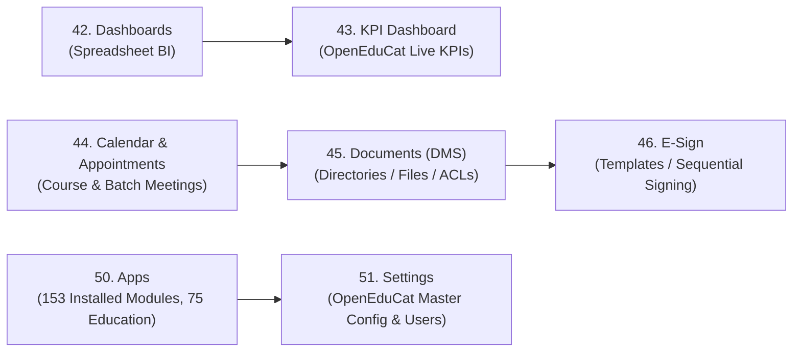

# 06 — Analytics, Productivity, Document Management, E-Sign & System Administration Modules

> **Source Instance:** `https://21058239.o19.oeducat.org` (Odoo 19 Enterprise / OpenEduCat SaaS)  
> **Target Client Context:** **Oshwal Academy Nairobi** (`https://oan.oshwalacademy.sc.ke/academics/`)  
> **Modules Covered:** Modules 42 (`Dashboards`), 43 (`KPI Dashboard`), 44 (`Calendar`), 45 (`Documents`), 46 (`E-sign`), 49 (`Spreadsheets`), 50 (`Apps`), 51 (`Settings`)

---

## Architecture Overview

---

## Module 42: Dashboards (`spreadsheet_dashboard.spreadsheet_dashboard_menu_root`)
- **Route:** `/openeducat/dashboards` (`ir.actions.client,515`)
- **Top Navbar:** `Dashboards`, `Configuration`
- **Left Sidebar Hierarchy (6 Groups, 10 Dashboards):**
  - **Sales:** `Sales`, `Product`
  - **Finance:** `Invoicing`, `Expenses`
  - **Logistics:** `Warehouse Metrics`
  - **Services:** `Helpdesk`
  - **Marketing:** `Events`
  - **Website:** `Live Chat`, `Live Chat - Ongoing Sessions`, `eCommerce`

---

## Module 43: KPI Dashboard (`dashboard_kpi.dashboard_pro_root`)
- **Route:** `/openeducat/action-111`
- **Top Navbar:** `My Dashboard`, `Create Dashboard`, `Demo`, `OpenEduCat`
- **Global Controls:** Date Range selector (`All Time`, `Today`, `This Week`, `This Month`, `This Quarter`, `This Year`, `Last 7 days`, `Last 30 days`, `Last 90 days`, `Last 365 days`, `Last Month`, `Last Year`, `Next Month`), `Refresh`, `Edit` layout builder.
- **`OpenEduCat` Executive Dashboard Widgets:**
  1. **Admissions Breakdown Table:** Grouped by `Course`, `Gender`, `Name` (12 records across `BCA-CC-Semester-2`, `BTECH-CE-Semester-1`, `BCOM-AF-Semester-1`, `BA-PY-Semester-1`)
  2. **Admissions Target Tile:** `12` (`12 of 50` target, `24%` completion bar, `View records` drill-down)
  3. **Fees Revenue KPI Tile:** `3M` total fees + secondary `780k` fees tile (`View records`)
  4. **Admissions by First Name Chart:** Bar/distribution chart
  5. **Student Attendance Status Widget:** `Done: 12`, `Draft: 30`
  6. **Quiz & Classroom Utilization Widgets:** Grouped by Name

---

## Module 44: Calendar & Online Appointments (`calendar.mail_menu_calendar`)

### 44.1 Sub-Menu Hierarchy
| Menu Path | Label | Route / Action | Target Model |
|---|---|---|---|
| `Calendar` | Calendar | `/openeducat/calendar` | `calendar.event` |
| `Online Appointment` | Online Appointment | `/openeducat/calendar-online-appointment` | `calendar.online.appointment` |
| `Configuration > Online Appointment Resource` | Online Appointment Resource | Configuration | Resource |
| `Configuration > Settings` | Settings | `/openeducat/res-config-settings` | `res.config.settings` |

### 44.2 Online Appointment & Calendar Event Forms
- **Online Appointment (`calendar.online.appointment`, `/openeducat/calendar-online-appointment`):**
  - **Preconfigured School Appointment Types (4):**
    1. `Meeting with Principle` (`COA001`)
    2. `Parents Meeting` (`COA002`)
    3. `Meeting with Management` (`COA003`)
    4. `Volleyball Court` (`COA004` facility booking)
  - **Form Fields:** `Team Leader`, `Duration (hours)`, `Pre-Booking Time (hours)`, `Appointment Schedule`, `Date Range`, `Appointment Up to (days)`, `Company`, `Unique Code`, `Is Published`, `Share URL` (e.g. `/booking/meeting-with-principle-1`), `Allow Cancellation`, `Description`.
  - **Notebook Tabs (5):** `Availabilities`, `Options`, `Slots`, `Message`, `Question`.
- **Calendar Meeting Form (`calendar.event`, `/openeducat/calendar`):**
  - **Fields:** `name` (Meeting Subject), `start_date`, `allday`, `location`, `res_id` (Linked record), `show_as`, `privacy`, `attendees_count`, `accepted_count`, `partner_ids`, **OpenEduCat extensions: `course_ids` (`Courses`), `batch_ids` (`Batches`)**, `notes`.
  - **Notebook Tabs (3):** `Notes`, `Options`, `Google Meet`.

---

## Module 45: Documents — DMS (`dms.main_menu_dms`)

### 45.1 Sub-Menu Hierarchy
| Menu Path | Label | Route / Action | Target Model | View Modes |
|---|---|---|---|---|
| `Files` | Files | `/openeducat/action-291` | `dms.file` | Kanban, List, Graph, Pivot, Form |
| `Directories` | Directories | `/openeducat/action-297` | `dms.directory` | Kanban, List, Form (Search Panel: `Parent Directory`, `Category`, `Tags`) |
| `Configuration > General Settings` | General Settings | Settings | `res.config.settings` | Form |
| `Configuration > Organizing > Tags / Categories` | Tags / Categories | Configuration | `dms.tag`, `dms.category` | List, Form |
| `Configuration > System > Storages / Migration / Access Groups` | System | Configuration | `dms.storage`, `dms.access.group` | List, Form |

### 45.2 Directory & File Forms
- **Directory Form (`dms.directory`):**
  - **Fields:** `image_1920`, `name`, `complete_name`, `is_root_directory`, `storage_id`, `inherit_group_ids`, `parent_id`, `size`, `count_elements`, `category_id`, `tag_ids`, `starred`.
  - **Notebook Tabs (7):** `Subdirectories`, `Files`, `Meta Information`, `Access Information`, `Groups`, `Complete Groups`, `Email Alias`.
- **File Form (`dms.file`):**
  - **Fields:** `image_1920`, `name`, `content` (binary upload), `extension`, `mimetype`, `directory_id`, `storage_id`, `category_id`, `tag_ids`, `create_date`, `create_uid`, `write_date`, `write_uid`.
  - **Notebook Tabs (2):** `Meta Information`, `Access Information`.

---

## Module 46: E-Sign (`esign_intg.esign_main`)

### 46.1 Sub-Menu Hierarchy
| Menu Path | Label | Route / Action | Target Model |
|---|---|---|---|
| `E-sign` | E-sign Templates | `/openeducat/e-sign-template` | `e.sign.template` (40 templates) |
| `Documents` | E-sign Requests | `/openeducat/e-sign-request` | `e.sign.request` (44 requests) |
| `Configuration > Field Types` | Field Types | Configuration | `e.sign.items` (`Signature`, `Initials`, `Name`, `Email`, `Phone`, `Company`, `Text`, `Date`, `Checkbox`, `Selection`) |
| `Configuration > Roles` | Roles | Configuration | `e.sign.item.role` (`Customer`, `Company`, `Employee`, **`Student`**) |

### 46.2 E-Sign Template & Document Request Forms
- **Template Form (`e.sign.template`):** Fields `Template name`, `Template`, `Tags`, `Who can Sign`, `Invited Users`, `Responsible`, `Document`, `Template Lines` + interactive PDF field placement viewer.
- **Signing Request Form (`e.sign.request`):**
  - **Header Buttons:** `Preview`, `Send a Copy`
  - **Statusbar Pipeline:** `Sent` → `Fully Signed`
  - **Fields:** `template_id`, `company_id`, `access_url` (`/esign/document/38`), `url`, `status_url`, `is_sign_order` (Sequential Signing Order boolean), `sign_with_key`, `request_item_ids` (`Contact`, `Role`, `Order`, `Responsible Key`, `State`).

---

## Module 49: Spreadsheets (`spreadsheet_base.spreadsheet_spreadsheet_menu`)
- **Route:** `/openeducat/action-513` (`spreadsheet.spreadsheet`)
- **UI Controls:** List view (`Name`, `Company`) with `New` and `Upload` buttons and inline `Edit` action.

---

## Module 50: Apps (`base.menu_management`)
- **Route:** `/openeducat/apps`
- **Top Navbar:** `Apps` (`Main Apps`, `Theme Store`, `Third-Party Apps`)
- **Installed Module Breakdown (153 Total Modules):**
  - `Education`: **75 modules** (`openeducat_*` core, enterprise, LMS, AI, OMR, grading, thesis, placement, alumni, campus, multi-location, transportation, library, digital library, face recognition, barcode, etc.)
  - `Human Resources`: **10 modules**
  - `Supply Chain`: **9 modules**
  - `Marketing`: **9 modules**
  - `Sales`: **8 modules**
  - `Website`: **8 modules**
  - `Productivity`: **7 modules**
  - `Extra Tools`: **6 modules**
  - `Services`: **4 modules**
  - `Accounting`: **3 modules**
  - `AI`: **3 modules** (`aio_agents`, `aio_playground`, `openeducat_ai_*`)
  - `Uncategorized`: **3 modules**
  - `Administration`: **2 modules**
  - `Tools`: **2 modules**
  - `Helpdesk`: **1 module** (`helpdesk_basic`)
  - `Appraisals`: **1 module**
  - `Sign`: **1 module** (`esign_intg`)
  - `Tool`: **1 module**

---

## Module 51: Settings (`base.menu_administration`)
- **Route:** `/openeducat/settings`
- **Top Navbar:** `General Settings`, `Users & Companies` (`Users`, `Companies`, `Roles`, `Board Affiliation`)
- **Left Sidebar Settings Sections (20):** `General Settings`, `Events`, `CRM`, `Whatsapp`, `Sales`, `Calendar`, `Online Tools Integration`, `Documents`, `Website`, `Purchase`, `Inventory`, `Invoicing`, `AI`, **`OpenEduCat`**, `Helpdesk`, `Email Marketing`, `Employees`, `Recruitment`, `Expenses`, `Fleet`.
- **Master `OpenEduCat` Settings Panel Feature Toggles:**
  - **OpenEduCat Enterprise:** `Instance Key`
  - **SIS:** `Terminology Configuration`, `Protected Names`, `Academic Plan`, `Achievement Enterprise`, `Activity`, `Activity Enterprise`, `Discipline Enterprise`, `Grievance`, `Health Enterprise`, `Subject Material Allocation`, `Scholarship Enterprise`, `Skill Enterprise`, `Student Mentor`, `Facility`, `Facility Enterprise`, `Parent`, `Parent Enterprise`, `Convocation`, `Student Feedback`, `Student Withdrawal Management`
  - **Admission:** `Admission`, `Admission Enterprise`, `Mass Subject Registration`, `Dynamic Admission`, `Create Student User`
  - **Academic & Assessment:** `Assignment`, `Attendance`, `Exam`, `Fees`, `Grading`, `OMR`, `Quiz` (`Quiz Enterprise`, `Quiz Anti Cheating`, `Secure QR: Secure/Open`), `Thesis`, `Timetable` (`Timetable`, `Timetable Enterprise`, `Lesson Enterprise`, `Batch Constraint`, `Batch and Subject Constraint`, `Classroom Constraint`, `Faculty Constraint`)
  - **LMS & Live Classroom:** `LMS` (`LMS Enterprise`, `LMS Admission`, `LMS Blog Enterprise`, `LMS Forum Enterprise`, `LMS Gamification Enterprise`, `LMS H5P Enterprise`, `LMS Sale Enterprise`, `LMS Survey Enterprise`), `Live Classroom Integrations` (`Bigbluebutton Enterprise`, `Google Meet`, `Teams`, `Zoom`)
  - **Campus & Operations:** `Alumni`, `Asset`, `Backend Theme`, `Backup`, `Campus`, `Classroom`, `CRM`, `Event`, `Job`, `Library` (`Library`, `Library Barcode Enterprise`, `Library Enterprise`, `Digital Library`), `Meeting`, `Notice Board`, `Online Appointment`, `Placement` (`Placement Enterprise`, `Placement Job Enterprise`), `Transportation`
- **Configured Internal Users (`res.users`, 9 accounts):**
  1. `Mitchell Admin` (`admin` — Administrator)
  2. `Marc Demo` (`demo` — User)
  3. `Ajay` (`backofficeadmin@openeducat.com` — Administrator)
  4. `Siddharth` (`backoffice@openeducat.com` — Administrator)
  5. `William D Mitchell` (`faculty@openeducat.com` — User)
  6. `Parth` (`librarian@openeducat.com` — User)
  7. `Global Calendar User` (`calendaruser@openeducat.com` — User)
  8. `Transport manager` (`transport_manager@openeducat.com` — User)
  9. `Transport User` (`transport_user@openeducat.com` — User)
