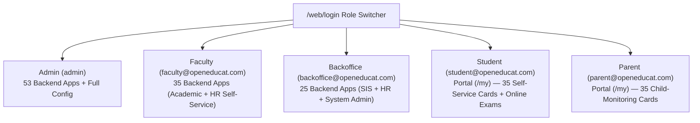
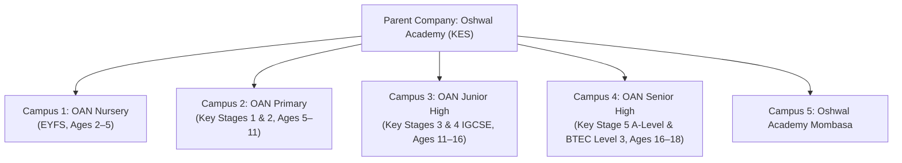

# 07 — Multi-Role Portals, Permission Matrix & Oshwal Academy Nairobi Custom Blueprint

> **Source Instance:** `https://21058239.o19.oeducat.org` (Odoo 19 Enterprise / OpenEduCat SaaS)  
> **Target Client Customization:** **Oshwal Academy Nairobi** (`https://oan.oshwalacademy.sc.ke/academics/`)  
> **Host-Verified Origins:** `https://21058239.o19.oeducat.org`, `https://oan.oshwalacademy.sc.ke`

---

## Part 1: Multi-Role Access & Permission Matrix (All 5 Login Personas)

### 1.1 Backend Module Visibility by Role (`Admin` vs `Faculty` vs `Backoffice`)

| # | Module Label | `Admin` (53) | `Faculty` (35) | `Backoffice` (25) | `Student` / `Parent` |
|---|---|---|---|---|---|
| 1 | `Admissions` | Yes | Yes | Yes | Via `/my` Portal Card |
| 2 | `Students` | Yes | Yes | Yes | Via `/my` Portal Card |
| 3 | `SIS` | Yes | Yes | Yes | Via `/my` Portal Card |
| 4 | `LMS` | Yes | Yes | Yes | Via `/courses` & `/my` |
| 5 | `Time Table` | Yes | Yes | No | Via `/my` Portal Card |
| 6 | `Class Attendances` | Yes | Yes | No | Via `/my` Portal Card |
| 7 | `Assignments` | Yes | Yes | No | Via `/my` Portal Card |
| 8 | `Exams` | Yes | Yes | No | Via `/my` Portal Card |
| 9 | `Grade Book` | Yes | Yes | Yes | Via `/my` Portal Card |
| 10 | `Job Queue` | Yes | No | No | No |
| 11 | `Quiz` | Yes | Yes | No | Via `/online-exams` & `/my` |
| 12 | `Thesis` | Yes | Yes | No | Via `/my` Portal Card |
| 13 | `OMR` | Yes | No | No | Via `/my` Portal Card |
| 14 | `Campus` | Yes | Yes | No | No |
| 15 | `Transportation` | Yes | Yes | No | No |
| 16 | `Library` | Yes | Yes | No | Via `/my` Portal Card |
| 17 | `Digital Library` | Yes | Yes | No | Via `/digital-library` & `/my` |
| 18 | `Events` | Yes | No | No | Via `/event` |
| 19 | `Placements` | Yes | Yes | No | Via `/website/activity/announcement` |
| 20 | `Alumni` | Yes | Yes | No | Via `/alumni` |
| 21 | `Fleet` | Yes | Yes | No | No |
| 22 | `Recruitment` | Yes | No | No | Via `/jobs` |
| 23 | `Job` | Yes | Yes | Yes | Via `/campus/jobs` |
| 24 | `OnBoarding` | Yes | No | Yes | No |
| 25 | `Human Resources` | Yes | Yes | Yes | No |
| 26 | `Time Off` | Yes | Yes | Yes | Via `/my` Portal Card |
| 27 | `Expenses` | Yes | Yes | Yes | No |
| 28 | `Approvals` | Yes | Yes | Yes | No |
| 29 | `Sales` | Yes | No | No | Via `/my` (`Your Orders`) |
| 30 | `Accounting` | Yes | No | No | Via `/my` (`Fees Statements`) |
| 31 | `Purchase` | Yes | No | No | Via `/my` (`RFQs`) |
| 32 | `Inventory` | Yes | No | No | No |
| 33 | `CRM` | Yes | No | No | No |
| 34 | `Website` | Yes | Yes | Yes | Public Frontend |
| 35 | `Email Marketing` | Yes | No | No | No |
| 36 | `Whatsapp` | Yes | No | No | No |
| 37 | `Live Chat` | Yes | No | No | Via `/my` (`LiveChat`) |
| 38 | `Surveys` | Yes | No | No | Via LMS / Links |
| 39 | `Contacts` | Yes | Yes | Yes | Via `/my` (`Addresses`) |
| 40 | `Discuss` | Yes | Yes | Yes | No |
| 41 | `Notice Board` | Yes | Yes | Yes | Via `/my` (`Notice Board`) |
| 42 | `Dashboards` | Yes | Yes | Yes | No |
| 43 | `KPI Dashboard` | Yes | Yes | Yes | No |
| 44 | `Calendar` | Yes | Yes | Yes | Via `/my` (`Academic Calendar`, `Meetings`) |
| 45 | `Documents` | Yes | No | No | Via `/my` (`DMS`) |
| 46 | `E-sign` | Yes | Yes | Yes | Via Signing Links |
| 47 | `Automated Marketing` | Yes | Yes | Yes | No |
| 48 | `Multi Campus` | Yes | Yes | Yes | No |
| 49 | `Spreadsheets` | Yes | No | No | No |
| 50 | `Apps` | Yes | No | Yes | No |
| 51 | `Settings` | Yes | No | Yes | No |
| 52 | `AIO` | Yes | Yes | Yes | Portal AI Agents (if enabled) |
| 53 | `Helpdesk` | Yes | Yes | Yes | Via `/my` / Website |

### 1.2 Student & Parent Self-Service Portal (`/my`)
When logging in as **Student** (`Emma J Parker`, `student@openeducat.com`) or **Parent** (`Jacob Parker`, `parent@openeducat.com`), `/openeducat` automatically redirects to `/my`:
- **Top KPI Summary Strip (Student):**
  - `5 Active courses`
  - `0 Pending assignments`
  - `0 Upcoming exams`
  - `8 Notifications` (Parent shows `2 Notifications` + banner *"Welcome Jacob — You're viewing your child's portal — quick access to all records and services."*)
- **Visual Analytics Row:**
  - **Attendance Trend:** 6-month line/bar chart
  - **Attendance Breakdown Donut:** `Present: 24`, `Absent: 9`, `Leave: 11`, `Late: 8`
- **Quick Action Bar:** `Edit information`, `My Timetable`, `Attendance`, `Assignments` (+ `Exams`, `GradeBook`, `Certificate` on Parent portal).
- **All 35 Portal Service Cards (`/my` Grid):**
  1. `Student Profile`
  2. `Exam Schedule`
  3. `Quiz Result`
  4. `Progression`
  5. `Assignments`
  6. `Courses`
  7. `Certificate`
  8. `OMR Exam`
  9. `OMR Exam Result`
  10. `Attendance`
  11. `Admission`
  12. `Timetable`
  13. `GradeBook`
  14. `Course Change Request`
  15. `Subject Registration`
  16. `Academic Calendar`
  17. `Thesis`
  18. `Digital Library`
  19. `Library`
  20. `Study Material`
  21. `Asset Requests`
  22. `DMS`
  23. `Fees Statements`
  24. `Your Orders`
  25. `Payment methods`
  26. `LiveChat`
  27. `Meetings`
  28. `Notice Board`
  29. `Grievances`
  30. `Time Off`
  31. `Addresses`
  32. `Connection & Security`
  33. `Online Meetings`
  34. `Requests for Quotation`
  35. `Our Orders`

---

## Part 2: Oshwal Academy Nairobi (`https://oan.oshwalacademy.sc.ke/academics/`) Custom ERP Configuration Blueprint

### 2.1 Live Audit of Oshwal Academy Nairobi (`oan.oshwalacademy.sc.ke`)
- **Institutional Profile:**
  - **Headquarters:** First Parklands Avenue, Off Mpaka Road, Parklands, P.O. Box 1130, 00606 Nairobi, Kenya (`oan@oshwalacademy.sc.ke`)
  - **Motto / Tagline:** *Compass for Life Skills*
  - **Key Institutional Metrics:** `30+` Subjects offered (including `5` world languages), `180` Teaching faculty (`80` men, `100` women), `6:1` Student-teacher ratio, `45%` Transition rate to world top universities.
  - **Accreditations & Exam Boards:** **Pearson Edexcel** (IGCSE, GCE A-Level), **Pearson BTEC** (Level 3), **ACT**, **SAT**.
- **5 Campus Locations (`Quick Links` in Footer):**
  1. **Oshwal Academy Nairobi — Nursery** (`nursery.oshwalacademy.sc.ke`)
  2. **Oshwal Academy Nairobi — Primary** (`primary.oshwalacademy.sc.ke`)
  3. **Oshwal Academy Nairobi — Junior High** (`junior.oshwalacademy.sc.ke`)
  4. **Oshwal Academy Nairobi — Senior High** (`senior.oshwalacademy.sc.ke`)
  5. **Oshwal Academy Mombasa** (`mombasa.oshwalacademy.sc.ke`)

### 2.2 Mapping Oshwal Academy Nairobi to OpenEduCat Models

#### A. Multi-Campus & Company Configuration (`Module 48: Multi Campus` / `res.company`)
Configure 1 Parent Institution (`Oshwal Academy`) and 5 Child/Branch Campuses (`res.company` with `currency_id = KES`):
- **Board Affiliation Tab (`res.company`):** Set to `Pearson Edexcel / British National Curriculum / Pearson BTEC / ACT / SAT`.
- **Terminology Configuration (`Settings -> OpenEduCat -> SIS -> Terminology Configuration`):**
  - Map `Course` → `Year Group` (e.g., `Year 1` to `Year 13`)
  - Map `Batch` → `Stream / Cohort` (e.g., `2026-2027 - Year 11 East`)
  - Map `Academic Term` → `Term 1 (Sep–Dec)`, `Term 2 (Jan–Apr)`, `Term 3 (May–Jul)`

#### B. Academic Divisions, Programs (`op.program`) & Courses (`op.course`)

| Oshwal School Division | Age Range | OpenEduCat `op.program.level` | OpenEduCat `op.program` | OpenEduCat `op.course` (Year Groups) | Curriculum & Subject Structure (`op.subject`) |
|---|---|---|---|---|---|
| **1. Kindergarten (Nursery)** | Ages 2–5 | `Early Years (EYFS)` | `Early Years Foundation Stage (EYFS)` | `Playgroup`, `Foundation 1 (Nursery)`, `Foundation 2 (Reception)` | **7 EYFS Learning Areas:** Communication & Language, Physical Development, Personal/Social/Emotional Development, Literacy, Mathematics, Understanding the World, Expressive Arts & Design. Evaluation: `Skill Assessment` (`openeducat_skill_enterprise`). |
| **2. Primary School** | Ages 5–11 | `Primary (KS1 & KS2)` | `Key Stage 1 (Years 1–2)` & `Key Stage 2 (Years 3–6)` | `Year 1`, `Year 2`, `Year 3`, `Year 4`, `Year 5`, `Year 6` | Core Literacy, Mathematics, Science, Computing, Humanities, 5 World Languages, Performing Arts, Sports, Outdoor Learning, Social Responsibility. |
| **3. Junior High (IGCSE)** | Ages 11–16 | `Secondary (KS3 & KS4)` | `Key Stage 3 (Years 7–9)` & `Key Stage 4 — Pearson Edexcel IGCSE (Years 10–11)` | `Year 7`, `Year 8`, `Year 9`, `Year 10 (IGCSE)`, `Year 11 (IGCSE)` | **KS3:** Broad foundational subjects. **KS4 (IGCSE):** Compulsory Core (`English`, `Mathematics`, `Sciences`) + `Elective` (`subject_type = Elective` via `Subject Registration` in Module 2/3 across 30+ subjects & 5 languages). |
| **4. Senior High (Pre-University)** | Ages 16–18 | `Sixth Form (KS5)` | `Key Stage 5 — GCE A-Level` & `Key Stage 5 — Pearson BTEC Level 3` | `Year 12 (AS-Level)`, `Year 13 (A2-Level)`, `Year 12 BTEC Level 3`, `Year 13 BTEC Level 3` | **GCE A-Level Pathway:** 3–5 Elective subjects (`min_unit_load = 3`, `max_unit_load = 5`). **BTEC Level 3 Pathway:** Coursework & continuous assignment evaluation (`Assignments` + `Rubrics Template` + `Grade Book`, no traditional final exam dependency) + University Careers Guidance (`Placements` & `Online Appointment`). |

#### C. Grading Scales (`Module 9: Grade Book` -> `op.grade.scale`)
Configure 4 distinct `op.grade.scale` records linked to their respective `op.course` records:
1. **`Pearson Edexcel IGCSE (9–1 Scale)`:** `9` (90–100%), `8` (80–89%), `7` (70–79%), `6` (60–69%), `5` (50–59%), `4` (40–49%), `3` (30–39%), `2` (20–29%), `1` (10–19%), `U` (0–9%).
2. **`GCE A-Level (A*–E Scale)`:** `A*` (90–100%), `A` (80–89%), `B` (70–79%), `C` (60–69%), `D` (50–59%), `E` (40–49%), `U` (0–39%).
3. **`Pearson BTEC Level 3 (D*–P Scale)`:** `Distinction* (D*)` (85–100%), `Distinction (D)` (70–84%), `Merit (M)` (55–69%), `Pass (P)` (40–54%), `Near Pass (N)` / `Unclassified (U)`.
4. **`EYFS / Primary Attainment Scale`:** `Exceeding`, `Expected`, `Emerging` (configured via `openeducat_skill_enterprise` Skill Levels & `op.grade.scale`).
