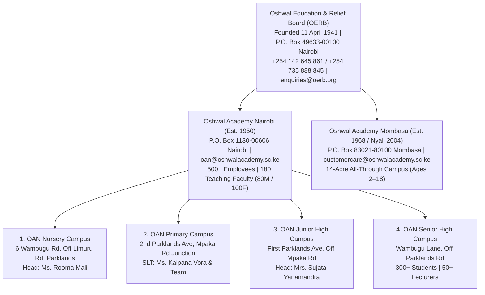
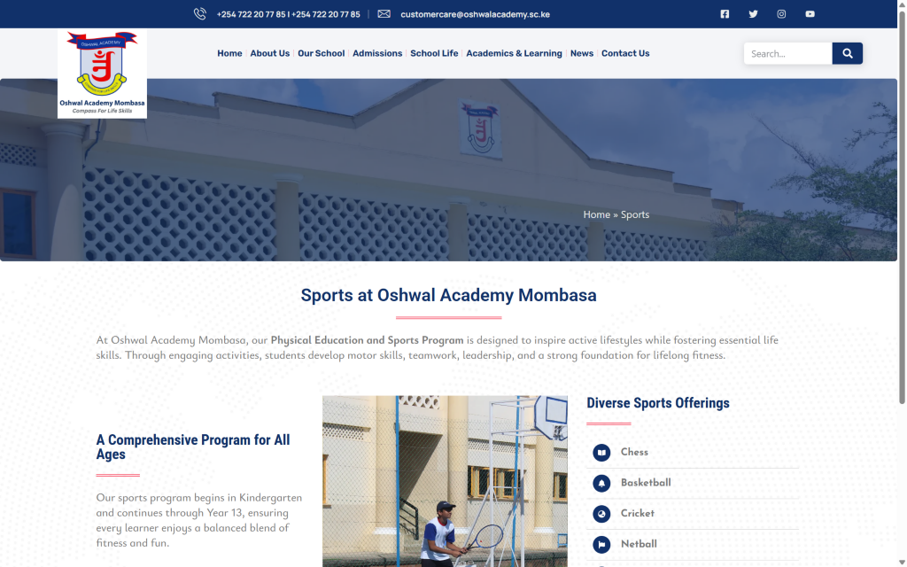

# 08 — Oshwal Academy (Nairobi & Mombasa) & OERB Institutional Deep Research

> **Host-Verified Domains Audited:**  
> - `https://www.oshwalacademy.sc.ke` (Root Portal — Nairobi & Mombasa Switcher)  
> - `https://oan.oshwalacademy.sc.ke` (Oshwal Academy Nairobi Hub — 52 Indexed Pages)  
> - `https://nursery.oshwalacademy.sc.ke` (OAN Nursery Campus — Parklands)  
> - `https://primary.oshwalacademy.sc.ke` (OAN Primary Campus — Parklands)  
> - `https://junior.oshwalacademy.sc.ke` (OAN Junior High Campus — Parklands)  
> - `https://senior.oshwalacademy.sc.ke` (OAN Senior High Campus — Parklands)  
> - `https://mombasa.oshwalacademy.sc.ke` (Oshwal Academy Mombasa — 14-Acre Nyali Campus)

---

## 1. Governance & Parent Body: Oshwal Education & Relief Board (`OERB`)

- **Historical Foundation:**
  - **OERB Founded:** Friday, **11th April 1941** at Jainshala Hall, Nairobi by 21 Oshwals representing 10 centres (First President: Shree Popatlal Karman Malde; First Secretary: Shree Raichand Karamshi Shah).
  - **Oshwal Academy Founded:** **1950** (originally Visa Oshwal School; Nursery Campus foundation stone laid **29th October 1967** by Mr. Hansraj Devan Shah and opened **6th October 1968** by Mr. Nyalchand Lagdhir Shah; Mombasa founded **1968** on Mombasa Island, Primary added **1981**, relocated to the 14-acre Nyali campus in **2004**).
- **OERB Office Bearers (2024–2026) (`/oerb/`):**
  - **Chairman:** Mr. Suhash Ratilal Shah
  - **Vice Chairman:** Mr. Mukesh Velji Savla
  - **Hon. General Secretary:** Mr. Nirmal Kirit Shah
  - **Assistant Secretary:** Mr. Samir Hasmukh Chandaria
  - **Hon. Treasurer:** Mr. Shital Shantilal Haria
  - **Assistant Treasurer:** Mr. Prakash Shantilal Haria
  - **Ex-Officio:** Mr. Nitin Pravinchandra Malde
  - **Managing Committee (12):** Mr. Jasmit Sureshkumar Sumaria, Mr. Tejul Gulabchand Shah, Mr. Jaideep Suresh Shah, Mr. Saagar Pravinchandra Shah, Mr. Ajay Somchand Shah, Mr. Darshan Maheshkumar Chandaria, Mr. Ashwin Amrutlal Shah, Mr. Sachin Mansukh Visariya, Ms. Dimple Darshit Shah, Ms. Shivani Samir Chandaria, Mr. Ajay Velji Chandaria, Mr. Pragnesh Gulabchand Chheda.
  - **Trustees (3):** Mr. Jitendra Harakchand Shah, Dr. Mansukh Jesang Maru, Mr. Mukesh Shantilal Malde.
- **Guiding Statements & Core Values:**
  - **Motto:** *Compass for Life Skills* (*"Inspiring and Growing Unique Greatness"*)
  - **Nairobi 7 Core Values:** `Trust`, `Honour`, `Courtesy`, `Integrity`, `Tolerance`, `Compassion`, `Humility`
  - **Mombasa 6 Core Values:** `Integrity`, `Creativity & Innovation`, `Diversity`, `Team Work & Collaboration`, `Empathy`, `Responsibility & Trust`

---

## 2. Master Directory of All 5 Campuses (Locations, Contacts & Leadership)

| Campus Code | Official Campus Name | Website Subdomain | Physical Street Location | Postal Address | Phone Numbers | Official Email | Head of School / Leadership |
|---|---|---|---|---|---|---|---|
| `OAN-NUR` | **Oshwal Academy Nairobi — Nursery** | `nursery.oshwalacademy.sc.ke` | 6 Wambugu Road, Off Limuru Road, Parklands, Nairobi | P.O. Box 1130 – 00606, Nairobi | `+254 722 291 833` / `+254 735 347 211` | `nursery@oshwalacademy.sc.ke` | **Ms. Rooma Mali** (Head of School) |
| `OAN-PRI` | **Oshwal Academy Nairobi — Primary** | `primary.oshwalacademy.sc.ke` | 2nd Parklands Avenue, Mpaka Road Junction, Parklands, Nairobi | P.O. Box 1130 – 00606, Nairobi | `+254 725 506 510` / `+254 736 743 660` | `primary@oshwalacademy.sc.ke` | **Ms. Kalpana Vora**, Mr. Joseph Musyimi, Ms. Anjana Vijayan, Mr. Samuel Kilolo, Mr. Anthony Wachira |
| `OAN-JNR` | **Oshwal Academy Nairobi — Junior High** | `junior.oshwalacademy.sc.ke` | First Parklands Avenue, Off Mpaka Road, Parklands, Nairobi | P.O. Box 1130 – 00606, Nairobi | `+254 725 529 622` / `+254 734 745 555` | `juniorhigh@oshwalacademy.sc.ke` / `oan@oshwalacademy.sc.ke` | **Mrs. Sujata Yanamandra** (Head of School); **Mrs. Jyotsna Chotai** (Academic Consultant) |
| `OAN-SNR` | **Oshwal Academy Nairobi — Senior High** | `senior.oshwalacademy.sc.ke` | Wambugu Lane, Off Parklands Road, Parklands, Nairobi (<5 min from CBD) | P.O. Box 1130 – 00606, Nairobi | `+254 721 821 962` / `+254 787 157 166` | `seniorhigh@oshwalacademy.sc.ke` | Senior High SLT (50+ Lecturers, 300+ Students) |
| `OAM-MBA` | **Oshwal Academy Mombasa** | `mombasa.oshwalacademy.sc.ke` | Off Beach Road, Nyali, Mombasa (14-Acre Campus) | P.O. Box 83021 – 80100, Mombasa | `+254 722 207 785` / `+254 735 839 777` | `customercare@oshwalacademy.sc.ke` | **Ms. Mildred Aseyo** (Head of School) |

---

## 3. Campus-by-Campus Academic, Interval & Operational Breakdown

### 3.1 OAN Nursery Campus (`nursery.oshwalacademy.sc.ke`)
- **Campus Motto:** *"Putting Children First"*
- **Framework:** British Early Years Foundation Stage (**EYFS**) across 7 learning areas (`Communication & Language`, `Physical Development`, `Personal, Social & Emotional Development`, `Literacy`, `Mathematics`, `Understanding the World`, `Expressive Arts & Design`).
- **Age Cohorts & Mandatory Staff-to-Student Ratios:**
  | Cohort / Year Group | Age Range | Class Size : Staff Ratio |
  |---|---|---|
  | `Playgroup` | 1.5 – 2.5 years | `20 : 3` |
  | `Pre-School` | 2.5 – 3.5 years | `25 : 2` |
  | `Kindergarten` | 3.5 – 4.5 years | `25 : 2` |
  | `Reception` | 4.5 – 5.5 years | `25 : 2` |
  | `Inclusive Education Dept (IED)` | 2 – 8/10 years | `10 : 3` |
- **Inclusive Education Department (`IED`) & Specialist Care:**
  - Operating hours: **Monday – Friday, 08:00 AM – 03:00 PM**.
  - Full-time multidisciplinary clinical team on campus: **Registered Nurse**, **Occupational Therapist (OT)**, and **Physiotherapist (PT)**.

### 3.2 OAN Primary Campus (`primary.oshwalacademy.sc.ke`)
- **Structure:** **Year 1 to Year 6** (`Key Stage 1`: Years 1–2; `Key Stage 2`: Years 3–6), organized into **6 year groups with 6 streams each (36 classes total)**.
- **Academic Curriculum:** **Cambridge International Curriculum (`CIE`)** for `English`, `Mathematics`, and `Science`, complemented by `Second Languages`, `Humanities`, `ICT`, `Art`, `Music`, and `PE`.
- **Inclusive Education Department (`IED`, Ages 7–20) & Learning Support:**
  - Implements the **ASDAN** curriculum and **9 vocational pathways**: `Hospitality`, `Hair & Beauty`, `Sports`, `Photography and Multimedia`, `Performing Arts`, `Computing Vocational Taster`, `Landbase`, `Office Assistance`, `Fashion and Design`.
- **Facilities:** Playhouse, Batting Cage, Gym, Quadrangle, smart classrooms with digital projectors and audio systems.
- **Club Intervals & Termly Sports Calendar:**
  - **Teacher-Led Non-Paid Clubs (Tuesday & Thursday afternoons):** Art & Craft, Board games, Home Science, Eco club, Scouting, Playground games, Lego, School Band, Oratorical club, Young Journalists club, MSMUN.
  - **Specialist Paid Clubs (`03:20 PM – 04:20 PM`, externally coached):** Taekwondo, Instrumental Music, Drama, Zumba, Chess, Ballet, Coding, First-Aid, LAMDA, Creative Arts & Craft, Badminton, Gymnastics, Yoga.
  - **Competitive Sports Calendar (Inter-class, Inter-house, KAIS & PIPSSA):**
    - *Term 1 (Sep–Dec):* Swimming, Soccer, Athletics, Cricket, Table Tennis, Badminton, Basketball
    - *Term 2 (Jan–Apr):* Swimming, Soccer, Table Tennis, Basketball, Hockey
    - *Term 3 (May–Jul):* Netball, Soccer, Table Tennis, Basketball, Rugby, Swimming

### 3.3 OAN Junior High Campus (`junior.oshwalacademy.sc.ke`)
- **Structure:** **Ages 12–16 (`Year 7 to Year 11` — Key Stage 3 & Key Stage 4 IGCSE)**.
- **Examination Boards:** Dual-accredited centre for **CAIE (Cambridge Assessment International Education)** and **Pearson Edexcel**.
- **IGCSE Subject Selection Workflow & Business Rules:**
  - Subject guidance begins in **Term 3 of Year 9**; IGCSE courses start in **Term 1 of Year 10** and culminate in final board exams at the end of **Year 11**.
  - **Standard Load:** **9 subjects** (Compulsory Core: `English Language`, `Mathematics`, and **at least 1 Second Language**).
  - **Extra Private Subject Rule:** Taking an additional private subject requires a **5-party signed undertaking** (`Student`, `Parent`, `Head of Department`, `Teaching & Learning Coordinator`, `Head of School`) and **strictly excludes subjects with coursework or practical examinations**.
- **Full Catalog of 28 IGCSE Subjects Offered:** `Accounts`, `Additional Mathematics`, `Art & Design`, `Biology`, `Business Studies`, `Chemistry`, `Computer Science`, `Drama`, `Economics`, `English Language`, `Environmental Management`, `Food and Nutrition`, `French`, `Geography`, `German`, `Global Perspectives`, `Gujarati`, `Hindi`, `History`, `Human Biology`, `Information & Communication Technology (ICT)`, `Literature in English`, `Mathematics`, `Music`, `Physical Education`, `Physics`, `Psychology`, `Swahili`.
- **Co-Curricular & International Competitions:** President's Award Kenya (Duke of Edinburgh), East African Model United Nations (EAMUN), World Scholar's Cup, Immerse International Essay Competition, University of Waterloo International Mathematics Competition, plus 20 active student clubs.

### 3.4 OAN Senior High Campus (`senior.oshwalacademy.sc.ke`)
- **Structure & Scale:** **Ages 16–18 (`Year 12 & Year 13` — Key Stage 5 / Sixth Form)**; **300+ Students** and **50+ Lecturers**; Office hours `Mon–Fri 08:00 AM – 04:30 PM`.
- **Accreditations & Testing Centre:** **Pearson Edexcel** (`IAS`, `IAL`, `BTEC Level 3 Extended Diploma`), **CAIE** (`AS & A-Level`), **ACT**, **SAT**, **IELTS**.
- **Pathway A — GCE AS & A-Level / International Advanced Level (IAL):**
  - **Admission Prerequisite:** Minimum **5 IGCSE credit passes (`Grade C` / `Grade 4` or higher), mandatorily including `English` and `Mathematics`**.
  - **Subject Load Rule:** **4 subjects in Year 12 (AS-Level)**, continuing **3 or 4 subjects in Year 13 (A2-Level)**; Exam series in **May/June** and **January** (`A*–E`).
  - **17 A-Level Subjects:**
    - *Pearson Edexcel IAL (9):* `Accounting`, `Biology`, `Business`, `Chemistry`, `Economics`, `English Language`, `English Literature`, `Mathematics`, `Physics`.
    - *CAIE AS & A-Level (8):* `Computer Science`, `Geography`, `Global Perspectives & Research`, `History`, `Information Technology`, `Law`, `Psychology`, `Sociology`.
- **Pathway B — Pearson BTEC Level 3 Extended Diploma (4 Specializations):** `Art & Design`, `Enterprise & Entrepreneurship`, `Hospitality`, `Sport` (2 years, equivalent to 3 A-Levels, 100% project/coursework assessed).

### 3.5 Oshwal Academy Mombasa (`mombasa.oshwalacademy.sc.ke`)
- **Campus Overview:** 14-acre purpose-built campus Off Beach Road, Nyali, Mombasa, serving **Ages 2–18** across 4 divisions under Head of School **Ms. Mildred Aseyo**:
  1. **Kindergarten (`Ages 2–6`):** `Playgroup` (Age 2), `KG 1` (Age 3), `KG 2` (Age 4), `KG 3` (Age 5) — **EYFS** & **IEYC**.
  2. **Junior School (`Years 1–6`):** **Cambridge Primary**.
  3. **Middle Years (`Years 7–9`):** **Cambridge Lower Secondary**.
  4. **Senior School (`Years 10–13`):** **Cambridge IGCSE** + **Cambridge International AS & A-Levels** + **Pearson Edexcel IAL**.
- **Campus Facilities (8 Core Zones):** Lecture Theatre, Library, Science Labs, Lego Room, Infirmary, Basketball & Tennis Courts, Canteen, Play Pens (+ Swimming Pool & Football Pitch).
- **Sports & Saturday Intervals:** 8 All-Age Sports (`Chess`, `Basketball`, `Cricket`, `Netball`, `Soccer`, `Swimming`, `Tennis`, `Badminton`) + Paid Saturday Enrichment (`Skating`, `LAMDA`).

---

## 4. Standardized OERB 7-Step Admissions, Compliance & Policy Rules

1. **7-Step Admissions State Machine:** `01. Inquiry` → `02. OERB Admission Form` → `03. Parents' & Head Teacher Interview` → `04. Entrance Assessment` → `05. Feedback & Offer Letter` → `06. Admission + Caution + Tuition Fee & Pupil's Pass Verification` → `07. Class/Stream Allocation (A–F) & Orientation`.
2. **8 Institutional Policies (`/policies/`):** `Admission Policy`, `School Fees Policy`, `Withdrawal Policy` (term's written notice for Caution Money refund), `Consequences of Misdemeanour`, `Substance Abuse Prevention Policy`, `Guideline Information to Parents`, `Media Consent Form`, `CCTV Privacy Policy` & `Liability Waiver`.
3. **Child Protection & Safeguarding (`/child-protection/`, `/health-and-safety/`):** Mandatory **Certificate of Good Conduct / Police Clearance / DBS** for all 500+ staff & volunteers, infirmary vaccination tracking, and termly **Fire**, **Duck-Cover-Hold**, and **Lock-Down** safety drills.
