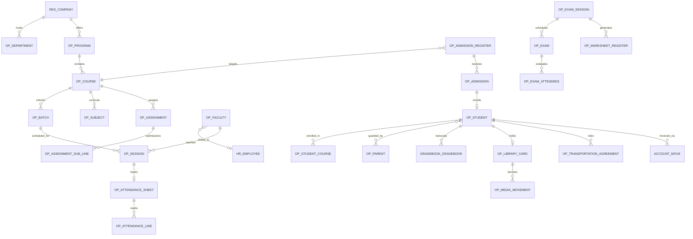

# OpenEduCat School ERP (Odoo 19 Enterprise) — Complete Reverse-Engineering Blueprint & Oshwal Academy Nairobi Customization Guide

> **Source Instance:** `https://21058239.o19.oeducat.org` (Odoo 19 Enterprise / OpenEduCat SaaS — 153 Installed Modules, 53 Top-Level Apps)  
> **Target Client Customization:** **Oshwal Academy Nairobi** (`https://oan.oshwalacademy.sc.ke/academics/`)  
> **Host-Verified Origins:** `https://21058239.o19.oeducat.org`, `https://oan.oshwalacademy.sc.ke`

---

## Documentation Suite Index

| Document | Scope & Contents |
|---|---|
| [01-ui-ux-design-system-and-public-website.md](01-ui-ux-design-system-and-public-website.md) | Global UI/UX design tokens, Typography (`Rubik`), Color Palettes, Navbar/Systray/Control Panel/Form/Chatter anatomy, Multi-Role Login (`/web/login`), and all **18 Public Website Routes**. |
| [02-core-education-modules.md](02-core-education-modules.md) | Exhaustive menu trees, models, views, form schemas, fields, buttons, smart buttons, and status pipelines for **Modules 1–6**: `Admissions`, `Students`, `SIS`, `LMS`, `Time Table`, `Class Attendances`. |
| [03-assessment-grading-and-research-modules.md](03-assessment-grading-and-research-modules.md) | Exhaustive specifications for **Modules 7–13**: `Assignments`, `Exams`, `Grade Book`, `Job Queue`, `Quiz`, `Thesis`, `OMR`. |
| [04-campus-library-transport-career-alumni-modules.md](04-campus-library-transport-career-alumni-modules.md) | Exhaustive specifications for **Modules 14–24, 41, 48, 52, 53**: `Campus`, `Multi Campus`, `Transportation`, `Fleet`, `Library`, `Digital Library`, `Events`, `Placements`, `Alumni`, `Recruitment`, `Job`, `OnBoarding`, `Notice Board`, `AIO`, `Helpdesk`. |
| [05-hr-finance-crm-marketing-and-backoffice-modules.md](05-hr-finance-crm-marketing-and-backoffice-modules.md) | Exhaustive specifications for **Modules 25–40 & 47**: `Human Resources`, `Time Off`, `Expenses`, `Approvals`, `Sales`, `Accounting`, `Purchase`, `Inventory`, `CRM`, `Website`, `Email Marketing`, `Whatsapp`, `Live Chat`, `Surveys`, `Contacts`, `Discuss`, `Automated Marketing`. |
| [06-analytics-productivity-ai-and-admin-modules.md](06-analytics-productivity-ai-and-admin-modules.md) | Exhaustive specifications for **Modules 42–46 & 49–51**: `Dashboards`, `KPI Dashboard`, `Calendar`, `Documents`, `E-sign`, `Spreadsheets`, `Apps` (153 technical modules), `Settings` (OpenEduCat master toggles & users). |
| [07-role-based-portals-and-permissions.md](07-role-based-portals-and-permissions.md) | Multi-Role permission matrix across all **5 Demo Roles** (`Admin`, `Faculty`, `Student`, `Parent`, `Backoffice`), 35-card Student/Parent Portal (`/my`), and **Oshwal Academy Nairobi Custom ERP Configuration Blueprint**. |
| [schemas/modules_and_menus.json](schemas/modules_and_menus.json) | Machine-readable JSON catalog of all 53 modules, XML IDs, routes, models, and role permissions. |
| [schemas/oshwal_academy_nairobi_config.json](schemas/oshwal_academy_nairobi_config.json) | Machine-readable JSON configuration blueprint for Oshwal Academy Nairobi (5 campuses, EYFS/KS1–KS5 British Curriculum, IGCSE/A-Level/BTEC Level 3 grading scales, and brand tokens). |

---

## Core Entity-Relationship Diagram (OpenEduCat Domain Model)

---

## Master 53-Module Inventory

| # | Module Label | XML ID (`data-menu-xmlid`) | Primary Landing Route | Core Models |
|---|---|---|---|---|
| 1 | `Admissions` | `openeducat_admission.menu_op_admission_root` | `/openeducat/admission-register-kanban` | `op.admission.register`, `op.admission`, `student.course.change.request` |
| 2 | `Students` | `openeducat_core.menu_op_student_root` | `/openeducat/student` | `op.student`, `op.subject.registration`, `op.student.progression` |
| 3 | `SIS` | `openeducat_core.menu_op_school_root` | `/openeducat/department-dashboard` | `op.department`, `op.program`, `op.course`, `op.batch`, `op.subject`, `op.faculty`, `op.parent` |
| 4 | `LMS` | `openeducat_lms.menu_lms_root` | `/openeducat/action-1376` | `op.course` (LMS extensions) |
| 5 | `Time Table` | `openeducat_timetable.menu_op_timetable_root` | `/openeducat/action-1288` | `op.session`, `op.lesson` |
| 6 | `Class Attendances` | `openeducat_attendance.menu_op_attendance_root` | `/openeducat/attendance-register` | `op.attendance.register`, `op.attendance.sheet`, `op.attendance.line` |
| 7 | `Assignments` | `openeducat_assignment.menu_op_assignment_root` | `/openeducat/assignment` | `op.assignment`, `op.assignment.sub.line`, `op.rubric.template` |
| 8 | `Exams` | `openeducat_exam.menu_op_exam_root` | `/openeducat/exam-session` | `op.exam.session`, `op.exam`, `op.exam.attendees`, `op.marksheet.register` |
| 9 | `Grade Book` | `openeducat_grading.menu_op_grading_root` | `/openeducat/grading-assignment` | `grading.assignment`, `gradebook.gradebook`, `op.grade.scale` |
| 10 | `Job Queue` | `queue_job.menu_queue_job_root` | `/openeducat/action-246` | `queue.job`, `queue.job.channel` |
| 11 | `Quiz` | `openeducat_quiz.op_quiz_main_menu` | `/openeducat/action-1334` | `op.quiz`, `op.question.bank`, `op.quiz.result` |
| 12 | `Thesis` | `openeducat_thesis.menu_op_thesis_root` | `/openeducat/thesis-registration` | `op.thesis.registration`, `op.thesis.progress`, `op.thesis.submission` |
| 13 | `OMR` | `openeducat_omr.menu_action_omr_root` | `/openeducat/omr_exam` | `op.omr.exam`, `op.answersheet.configuration` |
| 14 | `Campus` | `openeducat_campus_enterprise.menu_campus_management` | `/openeducat/campus-facility` | `op.campus.facility`, `op.facility.allocation` |
| 15 | `Transportation` | `openeducat_transportation_enterprise.menu_op_transportations_main` | `/openeducat/route-register` | `op.route.register`, `op.route.line`, `op.transportation.agreement`, `op.route`, `op.stop` |
| 16 | `Library` | `openeducat_library.menu_op_library_root` | `/openeducat/media-type-dashboard` | `op.media`, `op.media.unit`, `op.media.movement`, `op.library.card` |
| 17 | `Digital Library` | `openeducat_digital_library.menu_op_digital_library_main_root` | `/openeducat/category` | `op.digital.library.category`, `op.digital.library.material`, `op.digital.library.enrollment` |
| 18 | `Events` | `event.event_main_menu` | `/openeducat/events` | `event.event`, `event.registration` |
| 19 | `Placements` | `openeducat_placement_enterprise.menu_placement_main` | `/openeducat/internship-placement` | `op.activity.announcement`, `op.placement.offer`, `op.job.applicant` |
| 20 | `Alumni` | `openeducat_alumni_enterprise.menu_op_alumni_root` | `/openeducat/alumni-group` | `op.alumni.group`, `op.job.post` |
| 21 | `Fleet` | `fleet.menu_root` | `/openeducat/fleet` | `fleet.vehicle`, `fleet.vehicle.log.contract` |
| 22 | `Recruitment` | `hr_recruitment.menu_hr_recruitment_root` | `/openeducat/recruitment` | `hr.job`, `hr.applicant` |
| 23 | `Job` | `openeducat_job_enterprise.menu_job_main` | `/openeducat/job-post` | `op.job.post`, `op.job.applicant` |
| 24 | `OnBoarding` | `openeducat_onboarding.menu_op_onboarding_root` | `/openeducat/onboarding-steps` | `oe.onboarding.steps` |
| 25 | `Human Resources` | `hr.menu_hr_root` | `/openeducat/employees` | `hr.employee`, `hr.department` |
| 26 | `Time Off` | `hr_holidays.menu_hr_holidays_root` | `/openeducat/time-off` | `hr.leave`, `hr.leave.type` |
| 27 | `Expenses` | `hr_expense.menu_hr_expense_root` | `/openeducat/expenses` | `hr.expense` |
| 28 | `Approvals` | `multi_approval.menu_root` | `/openeducat/action-1000` | `multi.approval.type`, `multi.request` |
| 29 | `Sales` | `sale.sale_menu_root` | `/openeducat/sales` | `sale.order` |
| 30 | `Accounting` | `account.menu_finance` | `/openeducat/accounting` | `account.move`, `account.journal`, `account.payment` |
| 31 | `Purchase` | `purchase.menu_purchase_root` | `/openeducat/purchase` | `purchase.order` |
| 32 | `Inventory` | `stock.menu_stock_root` | `/openeducat/inventory` | `stock.picking`, `stock.quant` |
| 33 | `CRM` | `crm.crm_menu_root` | `/openeducat/crm` | `crm.lead` (with `Convert To Student`) |
| 34 | `Website` | `website.menu_website_configuration` | `/` | `website`, `website.page` |
| 35 | `Email Marketing` | `mass_mailing.mass_mailing_menu_root` | `/openeducat/email-marketing` | `mailing.mailing`, `mailing.list` |
| 36 | `Whatsapp` | `whatsapp_core.menu_action_whatsapp_root` | `/openeducat/action-1056` | `whatsapp.campaign`, `whatsapp.business` |
| 37 | `Live Chat` | `im_livechat.menu_livechat_root` | `/openeducat/livechat` | `im_livechat.channel` |
| 38 | `Surveys` | `survey.menu_surveys` | `/openeducat/surveys` | `survey.survey`, `survey.user_input` |
| 39 | `Contacts` | `contacts.menu_contacts` | `/openeducat/contacts` | `res.partner` (with `Is a Student`, `Is a Parent`, `Venue`) |
| 40 | `Discuss` | `mail.menu_root_discuss` | `/openeducat/discuss` | `discuss.channel`, `mail.message` |
| 41 | `Notice Board` | `openeducat_notice_board_enterprise.menu_main_notice_board` | `/openeducat/notice` | `op.notice`, `op.circular` |
| 42 | `Dashboards` | `spreadsheet_dashboard.spreadsheet_dashboard_menu_root` | `/openeducat/dashboards` | `spreadsheet.dashboard` |
| 43 | `KPI Dashboard` | `dashboard_kpi.dashboard_pro_root` | `/openeducat/action-111` | `dashboard.kpi` |
| 44 | `Calendar` | `calendar.mail_menu_calendar` | `/openeducat/calendar-online-appointment` | `calendar.event`, `calendar.online.appointment` |
| 45 | `Documents` | `dms.main_menu_dms` | `/openeducat/action-291` | `dms.file`, `dms.directory` |
| 46 | `E-sign` | `esign_intg.esign_main` | `/openeducat/e-sign-template` | `e.sign.template`, `e.sign.request` |
| 47 | `Automated Marketing` | `automated_marketing.automated_marketing_menu` | `/openeducat/marketing-campaign` | `marketing.campaign`, `marketing.activity` |
| 48 | `Multi Campus` | `openeducat_multi_location_enterprise.menu_main_multi_location` | `/openeducat/action-1231` | `res.company` |
| 49 | `Spreadsheets` | `spreadsheet_base.spreadsheet_spreadsheet_menu` | `/openeducat/action-513` | `spreadsheet.spreadsheet` |
| 50 | `Apps` | `base.menu_management` | `/openeducat/apps` | `ir.module.module` (153 installed) |
| 51 | `Settings` | `base.menu_administration` | `/openeducat/settings` | `res.config.settings`, `res.users` |
| 52 | `AIO` | `aio_agents.menu_aio_root` | `/openeducat/action-890` | `aio.agent.library`, `aio.workflow` |
| 53 | `Helpdesk` | `helpdesk_basic.helpdesk_basic_root_menu` | `/openeducat/helpdesk` | `helpdesk.ticket`, `helpdesk.team` |
